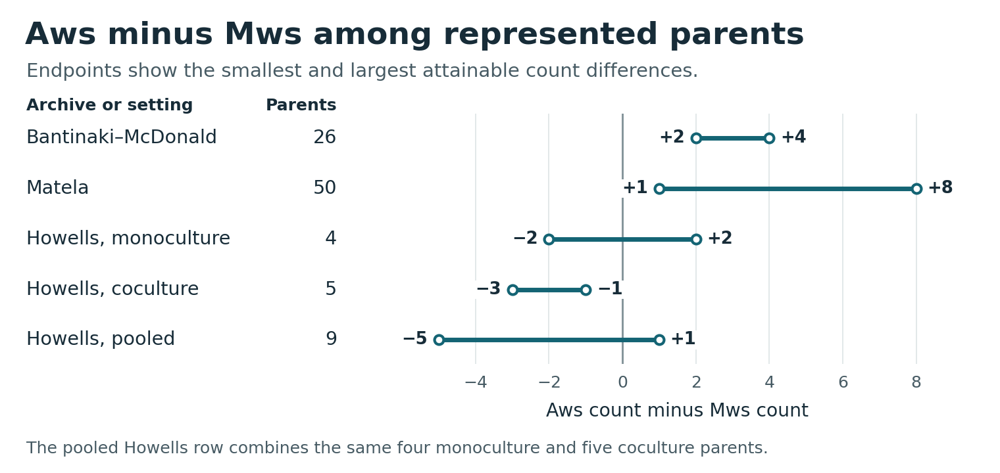

# Does the archived Wsp > Aws > Mws ranking travel to another collection?

**Only part of the earlier result carries over.** In two previously audited collections, the recorded categories forced Wsp > Aws > Mws when each represented parent population counted once. An independently generated collection from Howells and colleagues supplies a counterexample to carrying the Aws > Mws part of that ordering into every archived cohort. In its five coculture parents, two wrinkly records have a Wsp annotation, two have an Mws annotation and one has no matched focal annotation. Even giving that last record to Aws leaves Mws ahead, two to one. This is a statement about the published endpoint records under a specified counting rule. [Earlier two-collection audit](../archived_route_ranks/README.md) · [Howells et al., 2025](https://doi.org/10.1111/1462-2920.70061) · [Author workbook](https://doi.org/10.6084/m9.figshare.28340420)



The figure gives attainable count differences under each archive’s assignment rule. Each interval covers possible completions of a fixed roster. Its width describes label ambiguity.

## A third collection with paired phenotypes

Howells et al. generated their own populations and sampled both a wrinkly and a smooth endpoint from each retained parent. The study began with five monoculture and five coculture parents. One contaminated monoculture was excluded. Its two columns still appear in the mutation worksheet. Applying the paper's exclusion gives **four monoculture pairs and five coculture pairs**, consistent with the workbook's summary. Reading the full annotation sheet matters because Figure 3B filters genes by recurrence. The paper describes two unresolved monoculture wrinkly records in §3.4 and three unresolved wrinkly records overall in §4.2. [Methods §§2.2 and 2.6, Results §3.4 and Figure 3](https://pmc.ncbi.nlm.nih.gov/articles/PMC11847636/) · [Original workbook](https://api.figshare.com/v2/file/download/52114274)

| Context and selected endpoint | Parents | Wsp | Aws | Mws | No matched focal annotation |
|---|---:|---:|---:|---:|---:|
| Monoculture, wrinkly | 4 | 2 | 0 | 0 | 2 |
| Monoculture, smooth | 4 | 0 | 0 | 0 | 4 |
| Coculture, wrinkly | 5 | 2 | 0 | 2 | 1 |
| Coculture, smooth | 5 | 2 | 0 | 1 | 2 |

Each cell counts endpoint records with a matched family annotation under the workbook rule. No retained record had two different focal-family calls under that rule. Of the nine parent pairs, **three had a focal call in both endpoints, three only in the wrinkly endpoint and three in neither**. The two endpoints in each of the three doubly marked pairs shared the same family, with different listed entries within each pair. Thus a recorded family alone cannot distinguish the two phenotypes in those pairs. These are paired, phenotype-selected representatives. They supply no denominator for the prevalence of either phenotype in the underlying populations. [Annotation receipt](howells_receipt.json) · [Study](https://doi.org/10.1111/1462-2920.70061)

**What the unresolved records could change.** Hold each observed single-family label fixed. Give every unmatched wrinkly record one unrestricted slot that can contribute W, A, M or Other. This is a sensitivity calculation. A retained annotation could be incidental, and failure to match an annotation leaves the actual molecular cause open. Under that assumption the following are sharp bounds in numbers of represented parents.

| Wrinkly endpoint cohort | W minus A | W minus M | A minus M | Consequence |
|---|---:|---:|---:|---|
| Monoculture, 4 parents | 0 to 4 | 0 to 4 | −2 to 2 | W can tie a rival. |
| Coculture, 5 parents | 1 to 3 | −1 to 1 | −3 to −1 | M exceeds A for every completion. |
| Pooled, the same 9 parents | 1 to 7 | −1 to 5 | −5 to 1 | W exceeds A. Either W or M can lead. |

The pooled counts start at W = 4, A = 0 and M = 2, with three slots unresolved. To recover the earlier strict W > A > M ordering **all three** must be assigned to A, yielding (4, 3, 2). Assigning all three to M yields (4, 0, 5). These examples establish possibility. The archive supplies no probabilities for the different assignments. The pooled row reuses the two contexts and adds no independent replication. [Exact completions](howells_completion.json)

## How much did one school contribute to the Matela ranking?

Matela et al.'s 50 represented parents come from three schools contributing **39, 10 and 1**. The largest school contributes 34 W-only and five A-only parents. All five ambiguous parents occur in the two smaller schools. The workbook supplies five observed school-year groups. We compare three ways to summarize precisely these records. [Matela et al., 2026](https://doi.org/10.1128/aem.02499-25) · [Original Table S1](https://pmc-oa-opendata.s3.amazonaws.com/PMC13101516.1/aem.02499-25-s0002.xlsx) · [Anonymized group counts](block_receipt.json)

| How records are weighted | W minus A | W minus M | A minus M |
|---|---:|---:|---:|
| Each parent counts once, in parents | 28 to 33 | 31 to 39 | 1 to 8 |
| Mean of three school shares, percentage points | 21.45 to 68.12 | −10.94 to 75.73 | −39.06 to 14.27 |
| Mean of five school-year shares, percentage points | 40.46 to 68.46 | 27.23 to 79.23 | −17.23 to 14.77 |

For a concrete example, assign M to every parent whose records allow more than one class. The pooled counts are **W = 37, A = 7, M = 6**. Keep exactly those assignments and average the schools' shares equally. The result becomes **W = 39.06%, A = 10.94%, M = 50.00%**. That averaging gives the singleton school one third of the weight. Omitting the largest school instead leaves 11 parents with **W = 3, A = 2, M = 6**. Omitting either smaller school preserves the earlier strict order for every assignment. Neither averaging rule estimates an external population unless its weights describe that population. [Exact bounds, omissions and examples](weights_result.json)

### A 25% difference in parent weights permits an Aws–Mws tie

Let each school have one positive weight per parent, and let Γ bound the ratio of the largest weight to the smallest. The table gives the first ratio at which each pooled comparison can tie. A larger ratio permits reversal. The ratios describe sensitivity to a choice of weights, with every original record retained.

| Comparison | Smallest weighted numerator over weights in [1, Γ] | First possible tie |
|---|---:|---:|
| W minus A | 29 − Γ | 29 |
| W minus M | 34 − 3Γ | 34/3 |
| A minus M | 5 − 4Γ | 5/4 |

To obtain these values, minimize each pair's count difference within each school over the labels its parents allow. Call the resulting signed differences dₛ. At fixed positive weights, these minima can all be attained together for the specified pair. Giving weight 1 to positive dₛ and Γ to negative dₛ minimizes the numerator. Division by total weighted parent count preserves its sign. This gives a sharp threshold for the **sign**. The normalized gap at variable weights has a weight-dependent denominator.

For A minus M, the largest school contributes +5 and the smaller schools together can contribute −4. Giving the two smaller schools' parents 1.25 times the weight of the largest school's parents permits A and M to tie at 7.5 weighted votes each. The workbook supplies the counts. It supplies no estimate of bias equal to 25%. [Weight calculation](weights.py) · [Independent enumeration](verify_weights.py)

## What this changes for Mutation by Natural Dominance

A claim that these endpoint families always rank W > A > M has a concrete counterexample under the stated annotation rule. The project's fixed-axis hypothesis predicts a shared **supply-adjusted contrast** across specified contexts. It permits raw rankings to differ. These studies observe selected endpoints and supply neither first-arrival histories nor independent route-supply measurements for these cohorts. The calculations therefore narrow the empirical ranking claim while leaving the fixed-axis prediction open. [Model and its falsifiable prediction](../FORMULATION_AND_NEXT_EMPIRICAL_TEST.md)

A sharper next test would score a previously unseen archive against a ranking declared **for its sampling unit and context before reading its labels**. Report all represented and missing parents, use the same frozen annotation rule on paired phenotypes where available, and keep an unresolved category. For the mechanistic prediction, the independently measured supply and recovery terms specified by the model would also be needed. Choosing the successful weighting or category assignments after seeing this cohort would not supply a held-out test.

## Reproduce

The original workbooks remain at the primary-source links above. The saved JSON files contain aggregate counts and exact results. From the repository root, the count analyses use Python 3.10 or later. Reading the original spreadsheets uses openpyxl. The optional figure uses Matplotlib.

```sh
dir=research/archived_rank_robustness
python3 -B research/archived_route_ranks/replay_matela.py --source-blocks /path/to/aem.02499-25-s0002.xlsx | diff - "$dir/block_receipt.json"
python3 -B "$dir/weights.py" | diff - "$dir/weights_result.json"
python3 -B "$dir/verify_weights.py" --workbook /path/to/aem.02499-25-s0002.xlsx
python3 -B "$dir/replay_howells.py" /path/to/howells.xlsx | diff - "$dir/howells_receipt.json"
python3 -B "$dir/compare_howells_sources.py" /path/to/howells.xlsx /path/to/EMI-27-e70061-s001.xlsx | diff - "$dir/cross_source_receipt.json"
python3 -B -m research.archived_rank_robustness.complete_howells | diff - "$dir/howells_completion.json"
python3 -B "$dir/rank_margins.py"
```

The Matela verifier separately reads the workbook XML and enumerates all 32 parent-label completions. It checks the 33 pairwise intervals, four example tables, and six first-tie calculations across the two definitions of a group. The original two-collection audit remains reproducible through its existing commands. [Earlier replay instructions](../archived_route_ranks/README.md#exact-calculation-and-reproduction)

For Howells, the Figshare file contains 104,373 bytes and matches the publisher-registered MD5. The replay checks its SHA-256, reads all 257 data rows in the P. fluorescens matrix, and matches the published family names and aliases. It counts a numeric presence mark once per family per clone. Including the workbook's one nonnumeric deletion marker gives identical retained family sets. A separate read of the unfiltered worksheet, including multi-gene entries and the 18 retained columns, recovered the four-by-four annotation table above. The publisher’s separately hosted supplement has a different file digest and matches the Figshare copy on every decoded cell value across all eight sheets. These internal checks verify transcription and arithmetic. Causal assignment would require independent biological evidence. [Figshare source metadata](https://api.figshare.com/v2/articles/28340420) · [Publisher workbook](https://pmc-oa-opendata.s3.amazonaws.com/PMC11847636.1/EMI-27-e70061-s001.xlsx) · [Workbook comparison](cross_source_receipt.json) · [Published nomenclature](https://doi.org/10.7554/eLife.38822) · [Source replay](replay_howells.py)

The literature search used the study organism, wrinkly phenotype, independent populations, genome sequencing and archived-isolate terms, including a 2021–November 2026 date-limited search. Howells was included because its populations were generated separately, its two phenotypes were paired, and its full source matrix could be recovered. A further relevant study sampled visibly different phenotypes from another ancestral background. It answers a different sampling question. [Lind et al., Figure 1](https://doi.org/10.1038/ismej.2016.157)

All three collections were inspected retrospectively. This addendum accompanies the November 2026 GitHub checkpoint. The archival baseline is [report and methods 0.8.0](https://doi.org/10.5281/zenodo.24356344). Prepared 19 November 2026 UTC with AI assistance.
