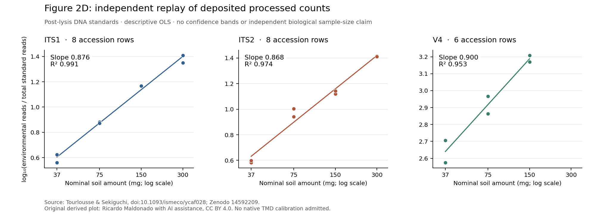

# R34: Figure 2D processed-count replay

An original Python calculation reproduces the deposited Figure 2D calibration summary from Tourlousse and Sekiguchi's [rDNA-mimic study](https://doi.org/10.1093/ismeco/ycaf028). All six slope and R² values agree with the archived author output at its displayed seven-decimal precision. This is a replay of a specified processed source table, not a native TMD fit or independent verification of absolute spike-copy truth.

The target was declared before our numerical replay: soil amount varied while the nominal standard dose stayed constant, as in Figure 2D. The alternative Figure 2B analysis was not used. We did not select an analysis by its result.

| Primer | Supplied accession rows | Soil amounts, mg | Replayed slope | Replayed R² | Author plot label: slope (R²) |
| --- | ---: | --- | ---: | ---: | --- |
| ITS1 | 8 | 37, 75, 150, 300 | 0.8758561902 | 0.9905208589 | 0.88 (0.99) |
| ITS2 | 8 | 37, 75, 150, 300 | 0.8675090473 | 0.9741363661 | 0.87 (0.97) |
| V4 | 6 | 37, 75, 150 | 0.9003616571 | 0.9534940140 | 0.90 (0.95) |

These high R² values describe the retained log–log relationships. The slopes are below one in this table; no statistical test against one, independent biological uncertainty estimate, recovery fraction or native transport claim follows. The two rows at each included primer/mass combination are accession records. Their biological or technical ancestry is not identified by the selected inputs.

## Authenticated artifacts and exact calculation

Two original archives were acquired from the fixed public [Zenodo record 14592209](https://doi.org/10.5281/zenodo.14592209): `data.tar.gz` (280,012 bytes) and `rmarkdowns.tar.gz` (8,757,587 bytes). Each matches the advertised MD5; newly computed SHA-256 identities are recorded in [SOURCE_PROVENANCE.json](SOURCE_PROVENANCE.json). Root and a separate reviewer inspected every archive header and hashed every regular member: 173 members, including 171 regular files, totaling 20,993,744 expanded regular bytes. No links, unsafe paths or special payloads were found. This inventory is not a scientific review of every dataset in those archives.

The selected table is `data/figure2D.tsv`, with 22 rows and 16 columns. The recipe is `rmarkdowns/figure2D.Rmd`; its archived output is `rmarkdowns/figure2D.html`. The spreadsheet counterpart was independently checked against the TSV. No author R, Rmarkdown, HTML script or original analysis environment was executed. The public Python code reads authenticated archive members into memory and reproduces only this declared calculation.

For each accession, let E be the supplied environmental read count and C the sum of all twelve named standard-count columns. We calculate y = log10(E/C) and x = log10(nominal soil amount in mg), then fit an ordinary unweighted straight line with intercept separately for ITS1, ITS2 and V4. The [join audit](JOIN_AUDIT.json) fixes each public accession's primer and nominal mass, all standard-column names, units and unresolved metadata. The explicit twelve-column sum agrees with the author's column-name rule. All supplied rows are retained, without a pseudocount, averaging, new exclusion or weighting. The ten other control columns have zero counts in these V4 rows, consistent with the source's stated V4 compatibility. They remain in the sum.

Slopes and R² are compared with the numbers printed in the deposited HTML, using an absolute tolerance of 5 × 10⁻⁸ for its seven-decimal display. The [full results](RESULTS.json) also retain intercepts and residual sums of squares. A separate reviewer uses high-precision Decimal arithmetic to check the calculation independently. These checks authenticate the represented computation, not the underlying experiment.

## What the joins support—and what remains missing

The main article reports approximately four million total rDNA-mimic copies for the varying-soil experiment. That approximate dose is context from the primary paper; it is not an independently measured per-accession field in the deposited Figure 2D table. The source's fluorescent DNA-mass measurements and Sanger identity checks do not establish exact introduced-copy truth. Input concentration, dilution and copy-conversion uncertainty are not propagated by this descriptive replay.

The table has no extraction-replicate ID, library-replicate ID or shared-pool membership. We therefore make no inferential confidence interval, effective biological sample-size or independence claim from the 22 accession rows. The fitted lines reproduce the source summary conditional on those rows; they do not supply TMD's physical-unit count law.

No 300-mg V4 rows occur in the supplied table. The primary paper explains excluding that condition because it yielded fewer than ten standard reads. The selected Rmarkdown begins with the already-processed table; it does not reconstruct that exclusion. Excluded accession IDs/counts and the full attempted-sample denominator are not recovered here. The retained rows cannot therefore establish an assay detection probability or invisible-loss bound. We also do not reconstruct FASTQ processing, denoising or environmental/standard classification upstream of this table.

The experiment's standards were added **after cell lysis by bead-beating**. The response measures a ratio of reads representing rRNA-gene/operon quantities. It cannot by itself measure cells lost before addition, differential cell lysis, viable cells, mutation births or lineage establishment. The comparison is useful because a named deposited table, recipe and author summary now agree under an independent implementation. Stronger calibration claims would additionally need actual row-level input quantities, their uncertainty, replicate provenance and relevant process matching.

A separately fitted calibration remains potentially assessable when parameters and count law are identified, joint uncertainty is propagated and a justified native transfer is frozen before evaluation. This replay neither supplies that native transfer nor turns an evaluation endpoint into its own independent predictor. No new theorem or biological TMD result is claimed.

## Verification, accounting and preservation

The verifier is read-only. Public-only use checks exact package membership, checksums, source facts, recorded arithmetic scope and frozen dependencies, while source replay is explicitly **UNRUN**. Supplying the two external original archives enables byte authentication, safe in-memory member reading, selected recipe/output checks and numerical replay. It writes no files, runs no source code and uses no network. Raw source counts, Rmarkdown, HTML, archives and author workstation paths remain outside Git; the plot and summaries are original derived outputs.

R34 uses two root scientific acquisitions: 9,037,599 original archive bytes plus 1,999 saved HTTP-receipt bytes, totaling 9,039,598 saved source bytes. This worker made no new network requests. Earlier primary, correction and license metadata are reused from R33, not counted as new acquisitions. Public source metadata declares CC BY 4.0; the source patent disclosure does not imply a laboratory-use license.

All 26 study and 18 planning fields remain NULL. No native stock, calibration record, independent mutation event, matched panel or native biological fit is admitted. Frozen R5/R11/R17, theta/eta forecasts, comparator set, error allocation, stopping, paused runner and methods 0.6.0 remain unchanged. No laboratory work, outreach or new project archive version is commissioned.

Original assessment, derived summary and plot: CC BY 4.0. Original Python replay and verification code: MIT. Ricardo Maldonado with AI assistance; third-party rights unchanged.
