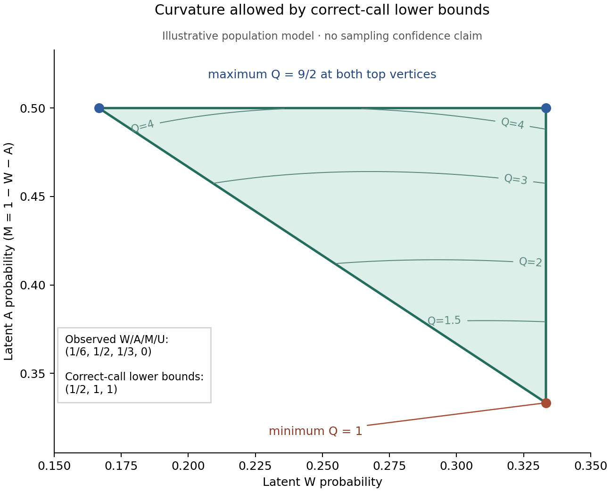

# Curvature bounds allowing wrong route labels

This observation-model extension allows a true W, A or M unit to be called as any of
W, A, M or U, where U retains unresolved and lost units. It derives exact
population curvature bounds from lower bounds on correct-call probabilities and
adds a conservative finite-count wrapper. All bundled examples are synthetic.
No native control panel, biological fit, new theorem or validated TMD mechanism
is supplied.

The distinction from [differential recovery](../conditional_recovery/MEASUREMENT_BRIDGE.md)
is substantive: that diagonal model cannot represent wrong labels entering other
route counts. A shared classifier can already change apparent curvature when the
biological W/M tilt changes. The present bounds retain that mixing. They permit
a different arbitrary classifier in each arm and context; imposing a single
shared matrix could tighten the answer. We do not claim sharpness for the shared
matrix problem or invert an estimated confusion matrix.

## Required frame

The eligible cohort must be independently prequalified to consist only of true
W/A/M units, with a frozen route definition and a common endpoint unit. Selecting
the cohort because its observed label is W/A/M does **not** establish this frame.
Every eligible unit contributes exactly one W/A/M/U outcome, including lost and
unresolved units. U is an observed state of a true-triad unit; it is not a true
Other category. Unknown true Other entrants or contamination invalidate the
three-column model. Cell, lineage, run, read and technical replicate denominators
cannot be exchanged without a justified sampling/transfer model.

The required classifier diagonal is a probability of a **correct route call**
among all independently known introduced true-route units. Recovery somewhere,
being callable or receiving a label is insufficient. Known-truth controls must
cover route/allele, arm, context, matrix, abundance, biological state and relevant
batch variation, or supply a justified one-sided transfer rule. A late spike-in
cannot calibrate earlier loss. Native prequalification, verified truth, valid
count laws and control transport are external premises; the program's explicit
contract strings record assertions and do not authenticate them.

## Exact population model and feasible set

For one arm/context let `p=(pW,pA,pM)` have strictly positive components summing
to one. Let `C` be a 4-by-3 nonnegative column-stochastic matrix with observed row
order W,A,M,U and true column order W,A,M. Set `o=Cp`, including the observed U
probability. Supply diagonal **lower bounds** `C[i,i] >= d_i`, with `0<=d_i<=1`.
The lower bounds need not equal the actual diagonals. A zero lower bound conveys
no correct-call information and is permitted.

The complete feasible set for `p` is

```
sum p_i = 1, p_i >= 0, p_i <= u_i,
u_i = min(1,o_i/d_i) if d_i>0, and u_i=1 if d_i=0.
```

Necessity follows from `o_i >= C[i,i]p_i >= d_i p_i`. For sufficiency, define
`v=(oW-dW*pW,oA-dA*pA,oM-dM*pM,oU)` and `R=sum(v)=1-sum(d_i*p_i)`.
The caps make `v` nonnegative. If `R>0`, set `z=v/R` and

```
C[j,i] = d_i*1[j=i] + (1-d_i)*z_j.
```

Each column sums to one, its diagonal is at least `d_i`, and `Cp=o`. If `R=0`,
every occupied column has `d_i=1`; use `z=(0,0,0,1)` in the same formula.
Unoccupied columns do not affect `o`. This constructs a classifier for every
feasible latent law. It may have `C[i,i]>d_i`, which is why these bounds are exact
for diagonal lower bounds and **not** for diagonals known to equal `d_i`.

The closed feasible set is nonempty precisely when `sum(u)>=1`. A strictly
positive feasible law additionally requires every `u_i>0`; then
`p_i=u_i/sum(u)` is a positive witness. An empty cap set or forced zero is an
observation-contract incompatibility / target-domain failure. The tool leaves
curvature unevaluable; it does not call that a rejection of biological curvature.

## Sharp curvature endpoints

Write `Q(p)=pA^2/(pW*pM)`. Define `a_min=max(0,1-uW-uM)`. If `a_min>0`,

```
Q_min = a_min^2/(uW*uM), at (uW,a_min,uM).
```

This is a lower bound because `pA>=a_min` and `pW*pM<=uW*uM`, and the point
attains it. If `a_min=0`, the infimum is zero. A closure point with A=0 and
positive W,M exists whenever the positive feasible domain exists; mixing it with
the positive witness approaches zero from within that domain.

For the upper endpoint take `a_max=uA`. Increasing A by proportionally decreasing
W and M strictly increases Q and preserves all caps, so a maximum can only occur
at this A limit. If `uA=1`, Q is unbounded. Otherwise put `s=1-uA` and

```
L = max(0,s-uM), H = min(uW,s),
D_min = min(L*(s-L), H*(s-H)).
Q_max = uA^2/D_min if D_min>0; otherwise +infinity.
```

The denominator `w*(s-w)` is concave, so its minimum on `[L,H]` is at an
endpoint. Finite extrema are attained in the positive domain. Zero and infinite
endpoints are limits, never claimed structural population zeros. The output
contains endpoint closure witnesses and a positive witness; their convex mixtures
give admissible approaching sequences. The constructive classifier above gives
exact population completion certificates for these witnesses, including U.

The positive feasible domain is convex and Q is continuous there. Its image is
an interval. For independent allowed classifiers in baseline and selected arms,
the sharp range closure of `J=Q(selected)/Q(baseline)` is

```
[Q_selected,min / Q_baseline,max,
 Q_selected,max / Q_baseline,min],
```

with zero/infinity treated as positive-domain limits. Across contexts, intersect
these intervals. Positive finite touching endpoints are included; zero/infinity
are not. A nonempty population intersection is compatibility with this specified
separate-classifier model, not a fit of a common matrix or evidence for a cause.

The following population example uses observed W/A/M/U probabilities
`(1/6,1/2,1/3,0)` and correct-call lower bounds `(1/2,1,1)`. The shaded
region contains exactly the allowed positive latent compositions; its sharp
Q range is `[1,9/2]`. It is an illustrative identification region, not a
confidence region or measured biological result.



The [SVG version](population_region.svg) is suitable for export.
`plot_population_bounds.py` regenerates both figures and requires optional
Matplotlib and NumPy; the inference tools use only the Python standard library.

## Conservative finite-count wrapper

Each arm/context provides all four counts W,A,M,U, and each true route provides
`introduced` and `correct` control counts with independently verified truth.
Missing entries are refused; a supplied zero denominator means genuinely zero
observations and yields an uninformative limit. Within each cell, the declared
fixed-denominator binomial marginal laws must be justified. Correlated descendants
or technical reads cannot be passed off as independent trials.

For C fixed contexts use `12*C` one-sided components: two arms times three route
labels times an upper observed-probability limit and a lower correct-call control
limit. Give each component error `alpha/(12*C)`. The preserved 0.5.0 scalar
Clopper–Pearson code supplies outward endpoints certified by exact binomial tails;
its bytes are hash checked before loading. Only the relevant one-sided endpoint
is computed. The certified binary-float endpoint is then converted to its exact
rational value before every division and comparison. There is no probability
smoothing or rounded curvature decision. Prototype limits are 64 contexts and
5,000 trials per cohort/control; alpha must be at least `1e-12` and below one.
The JSON interface refuses unknown or duplicate keys, nonfinite tokens, floating
probabilities and missing categories. Exact probability strings use integer,
fraction or finite decimal notation without exponents, with a 200-character and
256-bit numerator/denominator input limit. The CLI bounds input to one MiB. Before
confidence calculations, the wrapper limits
`sum_arms,contexts(3*N_observed + sum_routes N_control)` to 60,000. This work guard
is an operational prototype restriction, not a general wall-clock guarantee.

On the simultaneous coverage event,

```
o_i <= U_i, control_correct_i >= L_i,
native_C[i,i] >= control_correct_i,
p_i <= min(1,U_i/L_i), or cap 1 if L_i=0.
```

The union bound supplies simultaneous coverage at least `1-alpha` without
independence between cells. It does not repair an invalid within-cell marginal
law. The native-versus-control inequality is a substantive transfer assumption,
not inferred from the counts. If it has its own noncoverage probability, that
error needs a separately justified joint allocation; this implementation does
not include such an additional transfer error.

Project the resulting caps through the exact Q and J formulas. If at least two
context intervals are disjoint, the tool reports `reject_common_J=true`. Under
all contracts, the probability of falsely rejecting a common finite positive J
is at most alpha: on simultaneous coverage, every true J is contained in its
interval. If a cap set is incompatible, the result is unevaluable and does not
reject curvature. One context is descriptive. Overlap is `not_rejected`, not
proof of a feasible full confidence-region fit or equal biological curvatures.

These are conservative outer intervals. They discard other confidence limits,
simplex couplings in the observed probabilities, relationships between classifiers
and any shared-matrix restriction. Cap witnesses in count mode witness only the
cap outer set, not the full count-confidence region. The population sharpness
claim must not be transferred to this finite-count projection.

## True Other and the denominator boundary

If the true-triad eligible fraction T is unknown and there is an unrestricted
true Other column, let `p` describe the composition conditional on true-triad
membership. Necessity becomes `T*d_i*p_i<=o_i`. When all observed W/A/M
probabilities are positive, any positive triad composition can satisfy this by
choosing T sufficiently small. Give the true-triad columns their required
diagonals and distribute the residual observed mass arbitrarily; an unrestricted
Other column can fill the rest. Thus no positive lower bound on T means no
curvature identification in that positive-observation case. Population observed
zeros with positive diagonal bounds instead exclude the corresponding positive
true route; finite zero counts do not establish population zeros.

If an external argument guarantees `T>=beta>0`, the complete feasible conditional
triad set under an unrestricted Other column has enlarged caps
`u_i=min(1,o_i/(beta*d_i))`, with the same zero-bound convention. Necessity uses
T>=beta; sufficiency uses T=beta and distributes the common residual mass across
the unconstrained parts of all columns, including Other. This corollary is
documented to show the required information; the implemented contract fixes T=1.
It does not estimate beta or create a true-Other control from U counts.

For example, `o=(1/5,1/5,1/5,2/5)` and `d=(3/5,3/5,3/5)` force p uniform and
Q=1 in the implemented cohort. Renormalizing only the called labels first would
erase the U denominator and yield caps 5/9, with range `(0,infinity)`. More
generally, observed-label conditioning changes the model and cannot repair the
required independent cohort admission.

## Relation to earlier work and use

The existing [transport robustness](../transport_robustness/METHODS.md) supplies
diagonal recovery-bias identities, common-J projection and mismatch sensitivity.
The [prospective design](../prospective_design/README.md) already requires
route/allele-by-arm-by-context controls, retained denominators, a route registry
and transport constraints. [Identity-binding bounds](../identity_binding_bounds/README.md)
bound ambiguity of a row crosswalk, and [caller capture](../caller_capture/CONDITIONAL_DERIVATION.md)
uses finite joint correct-call masks and marginal bounds. None is replaced here.
This extension applies elementary stochastic completion, capped-simplex
optimization and established binomial confidence projection specifically to
off-diagonal W/A/M labels. It is not the first robustness analysis or a new
mathematical principle.

Run the examples and producer verification without external dependencies:

```sh
python3 classification_bounds.py example_shared_classifier.json
python3 classification_bounds.py example_count_separation.json
python3 verify_bounds.py
```

Selected bundled outcomes illustrate the scope:

| Synthetic case | Result |
| --- | --- |
| Earlier shared-classifier counterexample | Both context J intervals contain the true value 1; bounds are `[2/9,9/2]` and `[2/9,infinity)` despite observed J values 1 and 16/9. |
| Two chosen count tables with 900/1,000 correct truth controls per cell | At alpha 1/20 the A-rich context has J lower bound about 15.15; the A-poor context has upper bound about 0.364, so the conservative intervals separate. Decisions use exact stored rationals. |
| Same count tables, explicitly zero control observations | Both intervals expand to `(0,infinity)` and common curvature is not rejected. These are missing measurements, not supplied native controls. |
| U-retaining denominator example | Population Q and J are exactly 1 under the supplied lower bounds. |
| Incompatible population observation contract | The capped simplex is empty and curvature is left unevaluable. |

The count example can occur under a 90%-correct/10%-U classifier: its baseline
latent law is uniform and its selected laws are `(1/10,4/5,1/10)` and
`(9/20,1/10,9/20)`. Each endpoint cohort has 1,000 units and 100 U outcomes.
Truth-control counts of 900 correct among 1,000 introductions are possible under
the same diagonal probability. These tables are chosen possible realizations,
not a random simulation, power study or biological estimate.

The [independent review](INDEPENDENT_REVIEW.md) documents the separate geometric,
classifier-completion and finite-count checks. Its count coverage calculations
are per context under two declared synthetic laws, not biological power or a
complete multi-context study simulation. The [SLST assignment replay](SLST_CLASSIFICATION_DENOMINATORS.md)
extracts published table counts and audits a bounded archive roster; it supplies
no native classwise accuracy bound. The source-derived empirical control and
native-admission gaps remain unresolved.
The scientific scope is a conditional calculation and a precise requirement for
known-truth controls. No registry NULL, frozen forecast, study error allocation,
stopping rule, methods 0.6.0 artifact or paused runner is altered. No source-author
code or new biological experiment is run. The examples are chosen possible count
tables, not random replicates, power estimates or real effect sizes.

Original documentation is CC BY 4.0 and new code is MIT under repository terms.
Prepared with AI assistance. Internal independent computational review does not
constitute qualified external biological review.
