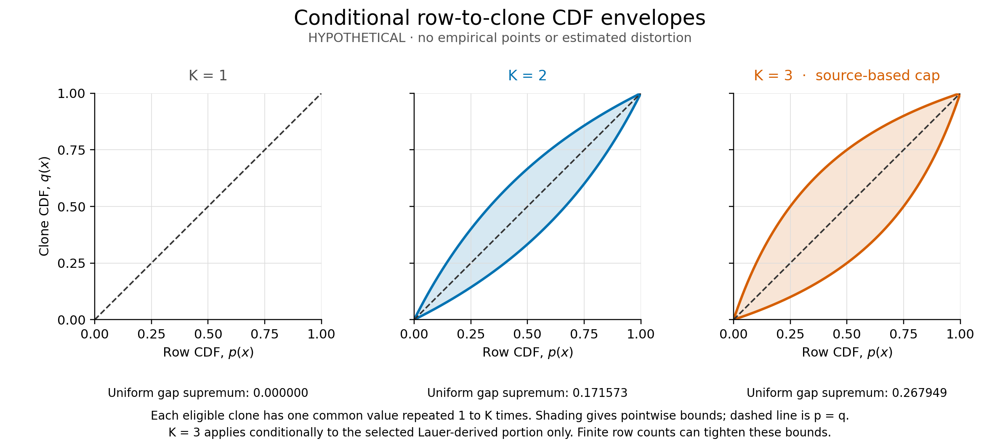

# Conditional sensitivity to repeated clone means

Ricardo Maldonado · 15 October 2026 · Original analysis with AI assistance

The source structure audited in R40 permits exact conditional bounds on the difference between a row-weighted empirical CDF and a CDF with one observation per eligible clone. For the Lauer-derived portion, the inspected script generates at most one fitted result per clone in each of three named runs and retains those rows when assigning a common clone mean. Under the assumptions below, each eligible clone therefore has multiplicity between one and three. This standard bounded-weight calculation gives a worst-case CDF gap supremum of approximately **0.267949**, across all possible population compositions. It is not an estimate of distortion in the study: the actual input rows, multiplicities and publication execution remain unknown.

The contribution is an original implementation and explicit application contract for familiar weighted-distribution bookkeeping. It supplies no new theorem, TMD predictor, confidence interval, biological fit, source replay or demonstrated source error. The comparison is entirely within the same selected clone frame. It does not concern all mutation births or establish a native W/A/M panel.

## Source basis and assumptions

The [R40 report](../cnv_fitness_pipeline_audit/REPORT.md) and [pipeline audit](../cnv_fitness_pipeline_audit/PIPELINE_AUDIT.json) document the authenticated cached artifacts. This analysis inspected them statically and did not execute or import author code. The [assumption contract](BOUNDS_CONTRACT.json) pins full-file and selected-line hashes.

The competition script excludes the named DGY500 and DGY1315 labels, constructs one fit per unique strain within run2, run3 and run4, combines those fit rows, and assigns the within-clone mean through operations that preserve rows. Its separate barcoded portion is appended later. The Figure 7 script excludes clone labels matching DGY1657 and applies a positive-coefficient selector to the competition rows. These are source facts, not authenticated observations about the unavailable tables.

The application requires all of the following:

1. The relevant table is generated by the inspected, unaltered pipeline with the documented row-preserving operations, without additional duplication or loss.
2. Clone identity is stable and valid: one label refers to one biological clone within the selected Lauer-derived portion, and a clone is not split across labels or merged with another clone.
3. Every retained per-run fit and every exported clone mean is a valid finite numeric value. A fitted clone contributes at most one row for each of run2, run3 and run4. At least one clone remains.
4. Each clone's exported rows have one identical mean value. The row and clone CDFs use the same ancestor exclusions and positive-mean selector, so each eligible clone is retained or removed as a whole.
5. The Lauer-derived portion is identified and considered on its own. The appended barcoded portion is outside these formulas' source-specific application.

If these conditions fail, the source-specific cap or the row-to-clone comparison may fail. The cap concerns exported-row multiplicity, not a count of biological replicates. Other run labels, failed fits, missing values, identity collisions, numerical parsing and execution provenance need the actual inputs to resolve. A different clone average or selector would define a different problem.

## Pointwise envelope from the row CDF

Let there be J eligible clones, each with a common mean m_j and integer multiplicity r_j in {1,...,K}. At threshold x define

\[
p(x)=\frac{\sum_{j=1}^{J}r_j\,\mathbf{1}\{m_j\le x\}}
{\sum_{j=1}^{J}r_j},\qquad
q(x)=\frac{1}{J}\sum_{j=1}^{J}\mathbf{1}\{m_j\le x\}.
\]

Here p is the empirical CDF over exported rows and q is the empirical CDF over unique eligible clones. Both use the same values and inclusive threshold convention. Repeated means remain repeated in p; different clones may also share a mean.

For an interior threshold, let a be the mean multiplicity among clones at or below x, and b that among clones above x. Then

\[
\frac{p}{1-p}=\frac{a}{b}\frac{q}{1-q},\qquad
\frac{1}{K}\le\frac{a}{b}\le K.
\]

Solving these inequalities for q gives

\[
\boxed{\frac{p}{K-(K-1)p}\le q\le
\frac{Kp}{1+(K-1)p}.}
\]

The endpoints p=0 and p=1 force q=0 and q=1. K=1 forces p=q everywhere. More generally, equal multiplicities across clones force p=q, even when their common multiplicity exceeds one.

These bounds are sharp with only p and K specified. For a rational p=u/v, the lower endpoint is realized by u left clones of multiplicity K and K(v-u) right clones of multiplicity one. The upper endpoint is realized by Ku left clones of multiplicity one and v-u right clones of multiplicity K. All values on one side can be placed below the threshold and all values on the other above it. These constructions show mathematical possibility, not actual clone identities. The plotted curves extend the formulas continuously to real p in [0,1].

## Uniform gap and its interpretation

The largest possible positive gap at a fixed clone fraction q occurs when the left multiplicity is K and the right multiplicity is one:

\[
p-q=\frac{Kq}{1+(K-1)q}-q.
\]

For K>1, its derivative is K/[1+(K-1)q]^2-1. It vanishes at q=1/(sqrt(K)+1), with p=sqrt(K)/(sqrt(K)+1). Reversing the two groups gives the negative-gap extreme. Hence every permitted configuration satisfies

\[
\sup_x|p(x)-q(x)|\le\frac{\sqrt K-1}{\sqrt K+1}.
\]

The right side is the sharp supremum over all finite clone populations of unspecified size and composition. For K=3 it equals 2-sqrt(3), approximately 0.267949. Because the optimizing clone fraction is irrational, no finite integer clone population attains that value exactly; rational clone fractions can approach it arbitrarily closely. For a particular known finite population the largest possible gap can be smaller. K=1 gives zero; K=2 gives approximately 0.171573. When sqrt(K) is an integer, the optimizing fractions are rational and finite attainment is possible.



*Figure: Pointwise mathematical envelopes for K=1, 2 and 3. All curves are hypothetical; no empirical observations are plotted. K=3 is the conditional cap from the inspected Lauer-derived source path. The dashed diagonal represents equal CDFs. Shading does not represent probability, confidence or sampling uncertainty. The uniform-gap annotations concern unknown population composition.*

## Exact finite bounds when counts are available

Suppose N>0 rows and k of them fall at or below the threshold. These are counts within the same selected Lauer-derived frame. Let B count unique clones on that side and A count unique clones on the other side. Since each clone contributes between one and K rows,

\[
\lceil k/K\rceil\le B\le k,\qquad
\lceil (N-k)/K\rceil\le A\le N-k.
\]

These intervals are exact: a total of t rows can be divided into c clone groups of sizes 1 through K if and only if c<=t<=Kc, including the zero-row, zero-clone case. To construct a division, give each clone one row and distribute the remaining t-c rows with capacity K-1 per clone. This constructive argument also proves endpoint attainment below.

When the unique clone count is unknown, q=B/(A+B) increases with B and decreases with A, giving

\[
\boxed{q_{\min}=\frac{\lceil k/K\rceil}{\lceil k/K\rceil+N-k},\qquad
q_{\max}=\frac{k}{k+\lceil (N-k)/K\rceil}.}
\]

These formulas also handle k=0 and k=N. The lower and upper endpoints generally use different total clone counts. They are both attainable given only N, k and K.

If J=A+B is known, define

\[
B_{\min}=\max\{\lceil k/K\rceil,\ J-(N-k)\},\qquad
B_{\max}=\min\{k,\ J-\lceil(N-k)/K\rceil\}.
\]

The exact endpoints are B_min/J and B_max/J, provided the integer inputs satisfy J>=1, J<=N<=KJ, 0<=k<=N and B_min<=B_max. Global totals alone do not establish threshold feasibility: for example N=6, J=2, K=3 forces both multiplicities to three, which makes k=1 impossible. The implementation rejects such cases.

These are exact extrema of a discrete feasible set; not every intermediate real number is attainable. Sharpness is conditional on the stated summaries only. A full observed row-value pattern, authenticated clone identities or further run information can tighten the feasible set. Endpoints at several thresholds need not be achievable by one common assignment of clone identities.

For a **HYPOTHETICAL** example, take N=7, k=3 and K=3, so p=3/7. The unrestricted envelope is [1/5,9/13], while the exact finite bounds are [1/5,3/5]. A lower-endpoint realization has left multiplicities (3) and right multiplicities (1,1,1,1); an upper-endpoint realization has left multiplicities (1,1,1) and right multiplicities (3,1). If J=4 is additionally known, the exact interval becomes [1/4,1/2]. None of these counts or assignments describes the study.

## Implementation and verification

[bounds.py](bounds.py) implements the rational envelope, finite-count bounds and optional integer endpoint witnesses using only the Python standard library. It uses exact Fraction arithmetic, rejects booleans and noninteger count inputs, rejects empty or infeasible frames, and deliberately accepts probabilities only as integers or Fraction objects. Endpoint witnesses are explicitly hypothetical. Bounds themselves do not allocate in proportion to N; constructing witnesses requires up to O(N) entries.

[test_bounds.py](test_bounds.py) independently enumerates all ordered bounded compositions for N=1,...,10 and K=1,...,4, then compares the actual reachable minimum and maximum clone fractions with the implementation for every threshold and candidate J. The oracle generates populations directly and does not reuse the ceiling formulas. Further checks validate constructive witnesses through N=30, rational-envelope endpoint attainment, equal-weight identity, exact arithmetic on 101-digit totals and invalid-input rejection. All nine test methods passed under Python 3.12.14. This is numerical verification of the original bookkeeping implementation, not biological or source-author validation.

Run from this directory:

```sh
python -m unittest -v test_bounds.py
MPLCONFIGDIR=/tmp/tmd-r41-mpl python make_figure.py
```

[make_figure.py](make_figure.py) creates the standalone [PNG](figure.png) and [SVG](figure.svg) scientific illustration using matplotlib 3.10.8. The arithmetic module and tests do not require matplotlib. Only the original R41 programs are executed.

## Admission boundary

No actual N, k, J, clone mean, multiplicity or CDF is inferred here. The unavailable competition CSVs and their applicable dataset terms remain unresolved; the repository's authenticated MIT software license does not license separate OSF data automatically. No source bodies or biological data are redistributed in this analysis. Actual reproduction still requires authenticated inputs, clone membership, selection and missingness records, and a source-execution record.

These bounds concern empirical CDF weighting. They do not determine density-plot heights, binning, bandwidth selection, a KDE change, or the separately appended barcoded component. They do not establish a publication error. They neither alter the sign selector nor turn it into a significance test. Statistical independence is unnecessary for this deterministic calculation; statistical or biological interpretation requires separate evidence.

All 26 study inputs and 18 planning inputs remain NULL; native W/A/M panels remain zero. R5/R11/R17, theta/eta, predictors, comparators, evaluation, error allocation, stopping, the paused runner and methods 0.6.0 remain unchanged. This analysis supplies no empirical TMD admission and no new methods version. Any review recorded with this artifact is internal and AI-assisted, not qualified external biological review.

## Separate recent-primary-source assessment

The [2026 source assessment](WATCH.md) concerns a distinct yeast mutation-accumulation study, not the unavailable Lauer/Avecilla CSVs or empirical data for these bounds. It reports genotype/environment associations between growth-based fitness and mutation rates, with generation-time, exclusion and detection controls. It does not validate TMD, establish the actual row-weight effect, or change frozen predictors. [Exact claim anchors](RECENT_SOURCE_ASSESSMENT.json).
