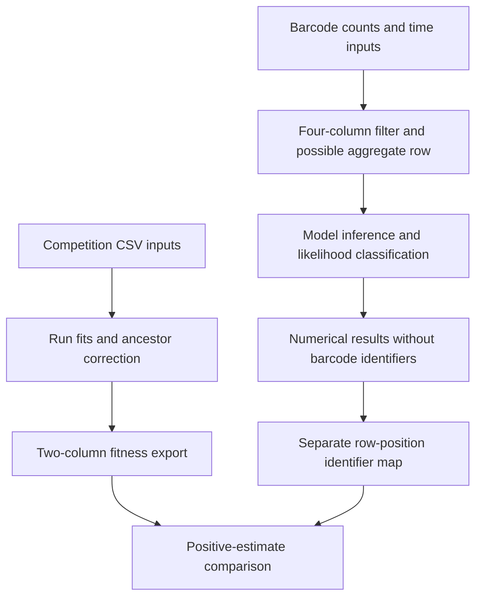

# Fitness-pipeline audit: rows, units and model-derived lineages

Ricardo Maldonado · 15 October 2026 · Original analysis with AI assistance

R40 authenticates three actual analysis artifacts and their repository MIT license for [Avecilla et al. (2022)](https://doi.org/10.1371/journal.pbio.3001633). Static inspection connects competition measurements, barcode processing, inferred lineage classification and the Figure 7 comparison inspected in R39. It also locates official versioned metadata for all three named competition CSVs. The CSV contents remain unrecovered, so no clone counts, numerical replay, alignment failure or published numerical error is established.

This is a source-reproduction advance for a conventional mutation–selection–drift comparator. It adds no new evolution cohort, independently observed mutation births, native W/A/M panel or TMD biological validation. The 2022 study reuses 2018 evolution populations, adding later assay measurements. Its fitness comparisons and inferred formation rate remain distinct validation targets.

## Three missing tables now have exact identities

The [official inventory](SOURCE_INVENTORY.json) records a public OSF project, nine root entries, three Fitness assays files and five Data from Lauer et al 2018 files. Each listing reports no next page. These are bounded folder inventories, not a complete recursive sample/event manifest.

| Named competition file | API-reported bytes | API current version | Literal download link |
| --- | ---: | ---: | --- |
| clone_fitness_pergen.csv | 1,534 | 1 | [c8awv](https://osf.io/download/c8awv/) |
| data_props_Lauer2018.csv | 30,118 | 1 | [8s4px](https://osf.io/download/8s4px/) |
| data_props_bc.csv | 25,545 | 1 | [9u7ka](https://osf.io/download/9u7ka/) |

Their API-reported SHA-256 values are recorded for future byte authentication. The three advertised sizes sum to 57,197 bytes; neither that total nor the supplied checksums authenticate local file contents. The download host is outside this runtime's enforced allowed-host set. No blocked download or workaround was attempted. A targeted public filename search found no mirror, which does not establish absence elsewhere. An exact-filename screen of 36,527 mounted archive files found no matching name; contents, alternate filenames and remote freshness were not assessed.

## Competition estimates retain a measurement contract

The authenticated `fitness_assays.R` reads both competition input CSVs. For Lauer-derived data it removes DGY500 and DGY1315, fits `transformed` against `hours` separately for run2, run3 and run4, and divides the slope by ln(2). It then assigns each clone its mean coefficient with group-by/mutate/select operations that preserve the retained clone/run fit rows. It does not explicitly collapse them to one row per clone. Actual recurrence and the deposited CSV's identity with this script's output require the tables and execution provenance.

For barcoded competitors, the script fits an ancestral-adjusted interaction model with three named ancestral strains and a run term. It divides the evolved-by-time interaction coefficient and its interval by ln(2). The nonbarcoded path leaves its intermediate slope interval unscaled while scaling the coefficient; those intervals are discarded before export, so this observation does not establish an error in a published interval. The final two-column export drops p-values, intervals and run labels. R39's later positive-coefficient selector is a sign filter, not a significance test.

There are two useful standard bookkeeping identities; neither is a new mathematical theorem or an estimate from these unavailable data.

For the Lauer-derived portion, suppose eligible clone j has an exported mean m_j repeated r_j times after the same exclusions and positive selector. Its row-based empirical distribution is

$$F_{rows}(x)=\frac{\sum_j r_j\,\mathbf{1}(m_j\le x)}{\sum_j r_j},$$

whereas one row per eligible clone gives $F_{clones}(x)=J^{-1}\sum_j\mathbf{1}(m_j\le x)$. The barcoded portion is appended separately and must also be identified before evaluating the combined distribution. This explains why actual row multiplicities matter; r_j is not a biological replicate count, and unequal multiplicities or an altered source plot have not been observed here.

For units, if the response is the same declared log-frequency ratio and generations satisfy g=νt for time t in hours, an hourly slope k_h corresponds to a per-generation Malthusian slope k_g=k_h/ν. The source's division by ln(2) is a literal documented convention in both code and article, not an independently calibrated time map in this audit. The approximate article description of 92 hours/about 16 generations is not substituted for an actual calibration. Input time units, transformed-column construction, reference growth and the intended selection-coefficient convention must be authenticated before comparing parameters or claiming a correction.

## Barcode identities pass through an inferred classification

The authenticated notebook explicitly comments that bc04 is bc01 in the paper. This resolves the existence of an author-provided alias statement, while leaving the biological sample and barcode crosswalk unverified. Its visible preprocessing retains four count columns, keeps rows with total counts at least 20, and combines lower-count rows into an aggregate tail row if any exist. The numerical model input contains no barcode identifier. Stored notebook outputs are not treated as a verified execution of the visible cells or accepted lineage counts.

The inspected FitMut script places per-lineage results at their numerical input indices and derives cell numbers using read counts, read depth and supplied cell depth. It forms an adaptive-minus-neutral log-likelihood difference, classifies positive differences as adaptive and nonpositive differences as neutral, and sets the latter fitness/establishment estimates to zero before CSV export. It also combines lineage-sized and time-sized arrays with padding. With this generating script and valid numeric outputs, a later positive-fitness selector can therefore inherit an upstream model classification. This is not a separately calibrated significance test or direct mutation-origin observer.

The R39 Figure 7 script attaches identifiers from another file by row position before joining barcode/population labels. Reconstructing the exact retained-row and possible aggregate-row manifest is consequently a prerequisite, rather than an optional cleanup. An unmatched CNV join remains a plotting classification, not independently DNA-genotyped negative truth.

These arrows describe static code dependencies. They do not prove that the inspected snapshots generated the deposited CSVs or published figure. The [pipeline audit](PIPELINE_AUDIT.json) and [code report](CODE_REPORT.md) pin source versions, selected line/cell anchors and explicit limits. No source-author code was executed.

## Next admission decision

The inspected repository license is MIT, copyright 2022 Grace Avecilla. It does not automatically license separate OSF datasets. The OSF project metadata supplies node_license null and no license relationship; applicable terms elsewhere remain unverified. Public files contain original analysis and selected bibliographic/identity facts, without full source bodies, code files, notebook outputs, author contacts, raw biological data or private archive locators.

The next useful acquisition is the actual three competition CSVs with lawful terms, verified bytes and a source-execution record, followed by clone membership, genotype/fluorescence crosswalk and selection/missingness records. Barcode analysis additionally needs the actual count/time inputs, filtered-identifier list and aggregate-row handling. Recovering these processed files would permit a source audit; it would not itself supply independent mutation births, invisible losses, establishment truth or native transport.

All 26 study inputs and 18 planning inputs remain NULL. R5/R11/R17, theta/eta, frozen predictors/comparators/evaluation, error allocation, fixed stopping, paused runner and methods 0.6.0 remain unchanged. No native biological fit, source numerical replay, new theorem or new Zenodo methods version is admitted. Independent review here is internal and AI-assisted, not qualified external biological review.
