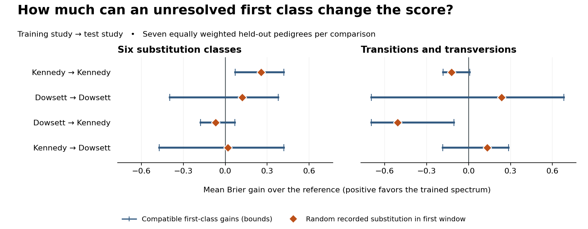

# Can a mutation spectrum predict the class of the first recorded change?

In one published baker’s yeast experiment, a forecast based on other families’ mutation spectra beat equal odds for six substitution classes in **all 36 assignments** compatible with the earliest recorded windows. Four of seven families had just one possible first class. Three of those four still had more than one possible first site. A second experiment gave a different answer. Its 1,858 changes in the first scored windows left **162,000 possible assignments** across seven families, and the data allow either forecast to win. Both studies used mutation-prone yeast pedigrees and share investigators. [Kennedy et al.](https://doi.org/10.1371/journal.pgen.1005151) · [Dowsett et al.](https://doi.org/10.1038/s42003-020-01544-6)

## Two questions that the same window can answer differently

The first target is the type of the earliest recorded single-base substitution. Within one observation window the molecular order can be unknown. We score the forecast for every first type consistent with the recorded calls, under the assumption that some member came first. The second target is the type of a substitution drawn at random from that window. The counts give its probabilities directly. For example, Kennedy pedigree H contains seven earliest calls. Four are C>A and the three others belong to three different classes. The draw gives C>A a 4/7 chance. Chronological priority could belong to any of the four classes. The Kennedy indices come from daughter observations, whereas Dowsett’s indices are replication cycles inferred from descendant inheritance. Missing earlier divisions, undetected changes, and truly simultaneous changes limit the interpretation of both studies. [Kennedy source reconstruction](kennedy/KENNEDY_SOURCES.md) · [Dowsett source reconstruction](dowsett/dowsett_source.md)

Each within-study forecast pools classified substitutions from all the other founding pedigrees in that study and adds one count per class. The uniform comparison gives each of six classes 1/6. We give each of seven held-out pedigrees equal weight. The summed multiclass Brier loss measures squared probability error. A positive gain means the trained forecast has a smaller mean loss. The endpoints below are attainable limits on the measured sample. The range describes missing order. Sampling uncertainty in a new set of families is a separate question. The analysis specification was committed before scoring, using published data and previously known window sizes. [Specification at first commit](https://github.com/maldonado-research/TMD/blob/b96c45a101350573c3309cb8b0a6efe503b412b5/research/first_window/DESIGN.md) · [Score derivation](SCORING.md)

| Training → test | First class identified | Possible joint assignments | Mean Brier gain, earliest class | Mean Brier gain, random recorded substitution |
|---|---:|---:|---:|---:|
| Kennedy → Kennedy | 4 of 7 | 36 | +0.0703 to +0.4186 | +0.2554 |
| Dowsett → Dowsett | 0 of 7 | 162,000 | −0.3959 to +0.3801 | +0.1205 |
| Dowsett → Kennedy | 4 of 7 | 36 | −0.1755 to +0.0696 | −0.0679 |
| Kennedy → Dowsett | 0 of 7 | 162,000 | −0.4713 to +0.4200 | +0.0192 |

The most probable Kennedy class, C>A, occurs in every primary earliest window. It must be first in B, D, E and the continuing G1 arm. These B, D and E windows each contain two C>A calls. Only G1 identifies one site. Across all seven families there are 20 earliest calls. The mean log-score gain is positive for every compatible assignment (+0.1127 to +1.0099 nats per family). On the additional G2 arm scored from its branch point, the six-class Brier gain spans −0.4786 to +0.4068. Both arms belong to G, and the whole family is excluded when training either fold. [Per-family forecasts and scores](results.json)

Dowsett’s four windows with six different types and three with five give 6⁴ × 5³ = 162,000 joint assignments. The trained spectrum helps predict a random recorded substitution even though the sign of its first-class advantage remains unknown. Combining the six classes into transitions and transversions also changes the result. The comparable binary reference assigns 1/3 to transitions and 2/3 to transversions. For the Kennedy within-study comparison, the binary gain spans −0.1825 to +0.0083. Transferring the Dowsett spectrum to Kennedy gives a **loss** under every admissible binary ordering (−0.6949 to −0.1055). Only the study-matched Kennedy forecast has a guaranteed positive mean gain in the four six-class comparisons above. Grouping the classes removes that guarantee. [Exact and secondary results](results.json)



## Does the Kennedy result require a special first-window effect?

As an exploratory check after the main scores were known, we preserved each path’s class counts, its first-window size, and its forecast. We asked how often a random set of that many recorded substitutions from each path would yield a worst-case Brier gain at least as large as the observed +0.07033. Under this exchangeable-window comparison, the exact fraction was **0.18313**. The expected worst-case gain was −0.00830. Assigning the single unlinked later F call to each class in turn gave tail fractions from 0.16760 to 0.20275. The result is compatible with ordinary variation in where the recorded classes fall. It supplies limited evidence for preferential timing beyond the families’ overall mutation spectra. Time-varying exposure, ascertainment and inheritance can violate the exchangeability assumption. [Exact calculation and independent replay](null/README.md)

Every coding of that unlinked Kennedy call retained a positive lower bound for the primary six-class gain (+0.06787 to +0.07262). Dropping one scored pedigree at a time while keeping the fitted forecasts fixed also retained positive lower bounds, with the smallest margin +0.01121 after omitting D. Reclassifying or excluding the two uncertain Dowsett entries left its primary interval spanning zero in all 49 scenarios. [Sensitivity calculations](sensitivity/README.md)

## An independent check on the class people actually recover

Weng et al. measured Arabidopsis mutation-accumulation lines at generation 25. In the 48 lines marked by the authors for the primary subset, there were 925 private substitutions. Predicting a random recorded substitution using the other 47 lines reduced the average Brier loss from **0.8333 to 0.6431**, with improvement in **46 of 48** held-out lines. Four of the 48 also appear in a shared-event file. Removing those four gave a similar gain (+0.1890, compared with +0.1902). All lines descend from a common founder. This confirms that class frequencies predict a sampled terminal substitution in this panel. The earlier mutation order and establishment outcomes are unobserved. [Plant calculations and source reconciliation](plant/README.md) · [Weng et al.](https://doi.org/10.1534/genetics.118.301721)

Recent Arabidopsis studies illustrate two reasons for specifying which mutations a forecast covers. Meyer et al. found that the somatic spectrum in shoots differs from that of germline mutations. Dong et al. reported nearly tenfold higher point-mutation accumulation in centromeres than elsewhere in the genome. Thus a tissue sample or a change in the accessible genome can alter the appropriate baseline. These published studies supply biological context for interpreting the plant comparison. Neither supplies first-event timing in the pedigrees scored here. This was a targeted literature check through 21 November 2026. [Meyer et al., 2025](https://doi.org/10.1073/pnas.2514194122) · [Dong et al., 2026](https://doi.org/10.1038/s41586-026-11046-w)

## What this tests for Mutation by Natural Dominance

The project asks whether mutation supply, context and subsequent persistence improve forecasts of evolutionary outcomes. The present test measures the predictive value of a familiar ingredient, a study-specific substitution spectrum. A separate measurement of accessible mutation opportunities, persistence or fitness would be needed to estimate their contributions. The equal-six comparison is a deliberately simple baseline. This test does not establish a new mutation mechanism or show which variant will dominate. A discriminating next observation would pair a recorded first class with a separately measured later fate in the same held-out pedigree and compare the added prediction against the frozen spectrum alone. The earlier handoffs identify this distinction between arrival, establishment and observation. [Project formulation](https://github.com/maldonado-research/TMD/blob/f14d1a086dac09f1f884a40743a75b40295f3df3/research/FORMULATION_AND_NEXT_EMPIRICAL_TEST.md)

## Reproduce the results

Run from this directory with Python 3.9 or newer. The primary calculations use the standard library. Regenerating the figure also requires Matplotlib. Each source note explains how to reproduce the included tables from the original authors’ supplements.

```sh
python3 -B compare_spectra.py | diff - results.json
python3 -B -m unittest test_score_bounds
python3 -B null/random_windows.py | diff - null/random_window_results.json
python3 -B null/verify_random_windows.py
python3 -B sensitivity/check_training_labels.py | diff - sensitivity/results.json
(cd plant && python3 -B score_weng.py | diff - results.json)
python3 -B plot_comparisons.py
```

Prepared for Ricardo Maldonado’s Mutation by Natural Dominance project with AI assistance. Source-specific attribution accompanies each derived dataset. Original calculations and verification code are MIT licensed and original documentation is CC BY 4.0.
