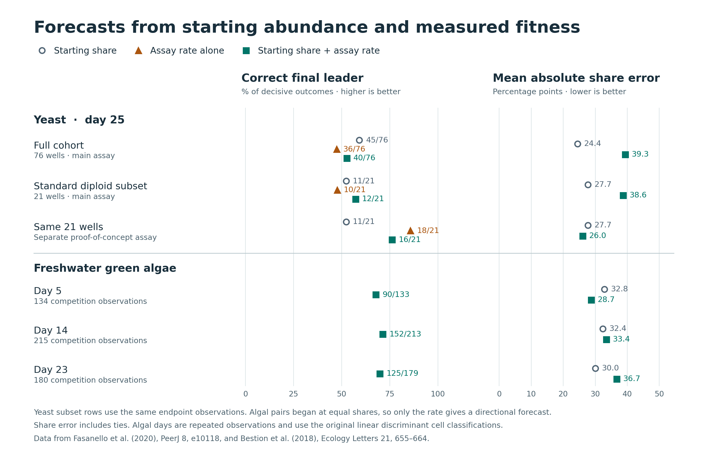

# Can founder fitness predict which competitor finishes ahead?

**Mutation by Natural Dominance · Report and methods supplement 0.12.0 · 20 November 2026 Pacific**

In 76 two-founder baker’s yeast populations, the founder that started ahead also finished ahead in **45**. Adding a separately measured fitness difference to its starting advantage gave **40** correct predictions and increased the average error in final share from **24.4 to 39.3 percentage points**. A second measurement of the founders changed the answer on the 21 wells for which it was available. On those identical outcomes, using the second assay improved the combined forecast from 12 to 16 correct. The starting count alone identified 11. The choice of assay matters to any prediction that treats founder fitness as a fixed input. [Fasanello et al.](https://doi.org/10.7717/peerj.10118) · [Primary analysis rules](FORECAST.md) · [Additional comparison rules](TRANSFER_RULES.md)

## What was predicted

The endpoint was the larger of two inherited yeast labels at the last sampled visit, day 25. Each label had a measured day-0 abundance and four fitness measurements from the generation-zero starting material. The ancestral assay measured relative growth over approximately 20 generations in a pool containing a common reference. The head-to-head follow-up lasted approximately 200–300 generations. The two experiments used the same medium in every comparison. Their transfer regimes matched in 54 of 76 wells. The source describes reviving stored material for the assay, so the forecast reconstructs what its founding measurements predict. The actual day-25 observations were already public when the analysis rules were fixed. [Source and linkage](FOUNDER_SOURCE.md) · [Previous release](https://doi.org/10.5281/zenodo.24382132) · [Primary rule commit](https://github.com/maldonado-research/TMD/commit/6e12cac37f68d253537e70d50b9d5e00a52fecd0)

For assay repeat $r$, let $A_{ir}, B_{ir}$ be the starting counts of the two founders and $A_{fr}, B_{fr}$ their final assay counts. The shared reference cancels within each paired measurement. For $R$ repeats and a follow-up of $T$ generations, the projected log odds for A are

$$
s=\frac{1}{20R}\sum_{r=1}^{R}\log\frac{A_{fr}B_{ir}}{A_{ir}B_{fr}},\qquad
\widehat L_T=\log\frac{A_0}{B_0}+Ts,\qquad
\widehat p_T=\frac{1}{1+e^{-\widehat L_T}} .
$$

Here $A_0,B_0$ are the starting counts in the head-to-head population. The sign of $s$ predicts which founder gains share. The sign of $\widehat L_T$ predicts which founder leads at the endpoint. These are different questions whenever a founder starts behind. If its measured rate advantage persists, its projected time to draw level is $-\log(A_0/B_0)/s$ when starting odds and $s$ have opposite signs. The crossing time is in generations. These equations apply the familiar constant-relative-growth model. No parameter was fitted to the endpoints. [Methods and executable score](score.py)

## Which conclusions depend on the measurement?

| Yeast comparison | Wells | Starting leader correct | Faster founder correct | Combined leader correct | Direction of gain correct | Starting-share error | Combined-share error |
| --- | ---: | ---: | ---: | ---: | ---: | ---: | ---: |
| Main ancestral assay, all conditions | 76 | 45 | 36 | 40 | 36 | 24.4 pp | 39.3 pp |
| Main assay, standard diploid subset | 21 | 11 | 10 | 12 | 11 | 27.7 pp | 38.6 pp |
| Separate 91-label assay, same subset | 21 | 11 | 18 | 16 | 11 | 27.7 pp | 26.0 pp |

The two 21-well rows score the same populations with the same starting counts and endpoints. The larger experiment includes these wells. Mean absolute error is the average distance in percentage points between the predicted and observed final fraction. None of these primary yeast forecasts or measured endpoints tied. [All-well results](results.json) · [Separate assay results](proof_assay/proof_native_receipt.json)

In the full panel, adding fitness corrected **9** baseline misses and lost **14** baseline hits. Both forecasts were correct in 31 wells and wrong in 22. The direction of the result survived a complete enumeration of the two observed endpoint readings for each of seven fully repeated sequencing pools. Across all **128** assignments the combined forecast lost **1–11** hits and increased mean share error by **11.8–17.5 points**. Six wells in the incompletely repeated eighth pool retained their original endpoint. These assignments measure sensitivity to the recorded endpoints. They have no probability weights. [Endpoint checks and code](library_sensitivity/README.md)

The measured *predictor* varied too. All four founding assay repetitions agreed on the fitter label in only **22/76** wells. That unanimous label finished ahead in **11/22**. Of the others, 33 wells split 3–1 and 21 split 2–2. Using the authors’ read-weighted ancestral summaries gave 40 correct fitness-only forecasts and 41 combined forecasts. Selecting a single repeat consistently within each of the twelve assay pools produced combined scores between **30 and 52**, with higher share error than baseline throughout. For comparison, observing the competition itself through day 10 supplied a later prediction with 55 correct from the day-10 leader and 57 from extrapolating its early change. The later forecast has ten additional days of information. [Technical checks](library_sensitivity/README.md) · [Earlier forecast benchmark](https://doi.org/10.5281/zenodo.24382132)

| Main assay group | Wells | Starting leader correct | Faster founder correct | Combined leader correct | Direction of gain correct |
| --- | ---: | ---: | ---: | ---: | ---: |
| Standard medium and transfer, both ploidies | 32 | 17 | 16 | 19 | 18 |
| Two stress conditions | 22 | 14 | 9 | 10 | 11 |
| Two altered transfer regimes | 22 | 14 | 11 | 11 | 7 |

The separate assay used another pool of 91 labels, ten technical repeats and source stocks corresponding to the founders in the standard diploid condition. Its ranking alone identified **18 of 21** endpoint leaders. The same ranking predicted the direction of change from baseline in **11 of 21**. In seven wells the stock assay correctly picked the final leader, but that founder had started ahead and lost share. The two assays agreed on the faster founder in only **9 of 21**. These observations cover **32 distinct founder labels in 16 distinct pairs**. Five pairs occur twice. The 18 successful forecasts share assay measurements, and every outcome also contributed to the main panel. Using both original endpoint sequencing libraries gave 15 of 21 stock-assay leader hits, compared with 18 using both repeats. Across the four possible pool choices the stock assay gave 15–18 leader hits and 10–11 gain hits. [Stock-assay endpoint sensitivity](proof_assay/ENDPOINT_LIBRARIES.md)

The observed change of result establishes sensitivity to the choice of fitness measurement. The assays differ in several respects, so these data cannot isolate a cause for that difference. [Separate assay data and methods](proof_assay/README.md) · [Original deposit](https://doi.org/10.5281/zenodo.3888967)

## An independent comparison in freshwater green algae

Bestion et al. measured monoculture growth separately from mixed-species competitions started at equal nominal densities. They had already shown that growth traits could often identify which species finished ahead. We used the mean measured slope at each exactly matching condition, applied the source’s base-10 growth convention and scored the **size** of the final fraction as well as its direction. This exploratory subset retained five species and ten pairs. At day 23, 180 of 360 candidate observations passed the density screen and had both rate estimates. The original classification method gave one tied endpoint. [Paper](https://doi.org/10.1111/ele.12932) · [Rows, exclusions, classifiers and replay](algae/README.md)

| Visit | Faster species led, decisive trials | Mean error using growth | Mean error using equal shares |
| --- | ---: | ---: | ---: |
| Day 5 | 90/133 | 28.7 pp | 32.8 pp |
| Day 14, authors’ primary visit | 152/213 | 33.4 pp | 32.4 pp |
| Day 23, final visit | 125/179 | 36.7 pp | 30.0 pp |

The rate projection improved the size estimate at day 5. At day 23 it picked the more abundant species in **69.8%** of decisive trials while making larger errors in the fraction than a fixed half-and-half prediction. Both alternative cell classifiers gave the same ordering of final-day errors. Density filtering changes the set of available trials across visits. The species, environmental conditions and repeated visits are shared. This is an ecological comparison of how a growth forecast transfers over time. It has a different biological unit from the yeast analyses. [Aggregate data](algae/results/algae_validation.csv) · [Sources and filtering](algae/README.md)

## A proposed test in 20 many-founder yeast populations

Khristich et al.’s September 2026 revision describes 282 natural yeast founders. Before scoring, we fixed a rule to estimate early relative growth in one group of ten populations and forecast the transfer-63 leader in the other ten, then reverse the groups. The public count file contains 327 distinct baseline labels across these populations, with 12–320 detected per population. The revised reference workbook lists 371 different labels across 388 rows. It includes ambiguous and repeated labels. We could verify the visits, read counts, and source processing plates. We could not verify which exact 282 natural founders and label aliases belonged to this pool. Replicate-number groups also separate processing plates at baseline and share them at later visits. **This comparison has no forecast score.** A founder-to-label inclusion map would allow the fixed rules to be applied to the intended competitors. [Revised study](https://doi.org/10.1101/2025.10.09.681448) · [Coverage record and source checks](multifounder/README.md) · [Fixed comparison](TRANSFER_RULES.md)

## What the result changes for TMD

TMD asks which new mutational route first becomes established. The outcome here is the abundance of an inherited label. Several variants can arise within one label. Even with exact initial and final shares, the change in log odds identifies only the integral of relative growth over the interval. Growth histories with different timing can have the same integral. Dating and identifying a new mutation requires another observation. For the narrower question of future abundance, the data identify three quantities worth scoring separately. They are the endpoint leader, the direction of share change and the size of the final share. The 21-well comparison shows how accurately identifying an endpoint leader can coexist with weak prediction of the direction of gain. The algae comparison shows how often getting the ordering right can coexist with poor prediction of the magnitude. [Original TMD formulation](https://github.com/maldonado-research/TMD/blob/f14d1a086dac09f1f884a40743a75b40295f3df3/research/FORMULATION_AND_NEXT_EMPIRICAL_TEST.md)

A direct test would require independently identified route-level events, comparable observation windows, evidence distinguishing new events from inherited variation, and a prespecified operational definition of establishment. A comparison of abundance forecasts can already be specified more precisely by fixing the source of the fitness measurement, the forecast horizon, the treatment of starting shares and the baseline forecast before opening held-out results. Record both final-rank accuracy and error in final share. Fink and Manhart’s November 2026 methodological treatment of competitive fitness explains why the information in an assay depends on the growth context and the time interval over which it is measured. [Quantifying microbial fitness in high-throughput experiments](https://doi.org/10.7554/eLife.102635)

The primary comparison and the additional yeast rules were fixed at different stages. The primary rules predate linking the founding measures to the outcomes. The stock-assay and cross-population rules were fixed after the primary score was known before the stock-assay scores were computed and before checking whether the many-founder comparison could be scored. The algae comparison was exploratory. [Primary rule commit](https://github.com/maldonado-research/TMD/commit/6e12cac37f68d253537e70d50b9d5e00a52fecd0) · [Additional rule commit](https://github.com/maldonado-research/TMD/commit/a6640f2cc670748b64a7e194cb48efd5585e9913)

## Reproduction

From the directory containing this report, run `bash replay.sh` with Python 3.11 or later. The standard-library replay uses the anonymous source-derived counts and compares its outputs with the saved results. Signs of primary yeast forecasts use rational comparisons so near-equality cannot flip the winner through floating-point rounding. Encoded signs in results.json denote A (+1), B (−1) and a tie (0). The source-specific guides describe checks against the authors’ original files. Results and writing were prepared for Ricardo Maldonado’s TMD project with AI assistance. [Founding-assay sources](FOUNDER_SOURCE.md) · [Endpoint-library checks](library_sensitivity/README.md) · [Algal source replay](algae/README.md)
