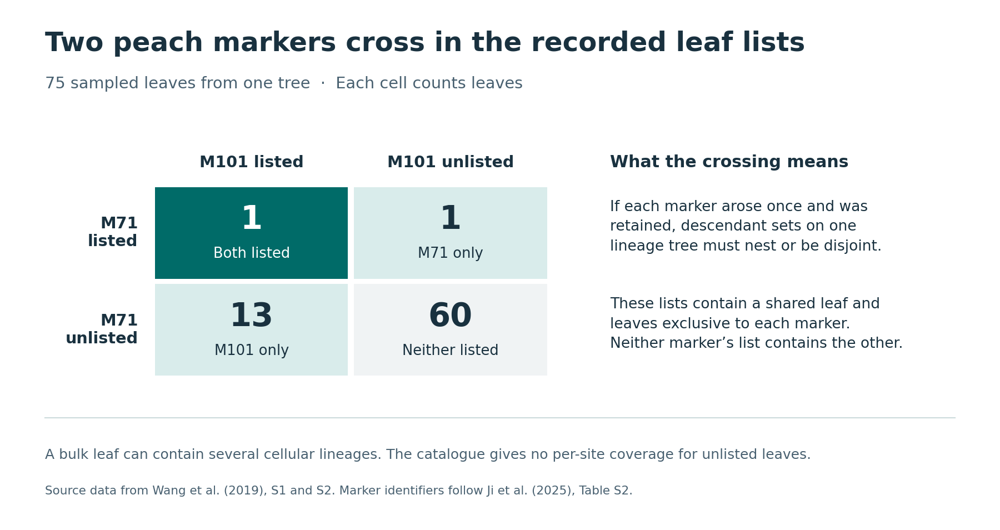

# What can a tree’s surviving leaves tell us about mutation order?

**Three mutations were recorded in 27, 14 and eight of the same 29 peach leaves. None of the three carrier lists contains either of the others.** For each pair, at least one leaf carries both reported markers and there are leaves unique to each marker. The counts in decreasing order suggest a possible sequence of events, but the individual leaves do not form the nested groups that this simple reading would require. Wang and colleagues previously described the branch frequencies and interpreted them in terms of a hierarchy of cell divisions. Their published Figure 4 records the leaf-level patterns that let us examine that interpretation. [Wang et al., 2019](https://doi.org/10.1371/journal.pbio.3000191) · [Original Figure 4](https://doi.org/10.1371/journal.pbio.3000191.g004) · [Position-level check](topology/PHYSICAL_GROUPS.md)

A single irreversible mutation on a rooted lineage tree marks a group of descendants. If a second mutation occurs within that lineage, its descendants are a subset of the first group. Mutations on separate branches give disjoint groups. Applying that reasoning to bulk leaves requires each leaf’s recorded markers to describe a single lineage accurately. A leaf can contain multiple cellular lineages, and unlisted site–leaf calls have uncertain sensitivity. Either feature can produce crossing lists. Agreement with recorded branch labels also needs care here because the 2019 study used branching information during variant discovery. [Source design and recent plant-lineage literature](PEACH_SOURCES.md)

## The 48 markers in the peach catalogue

Wang et al. studied 75 leaves from four main branches of one sapling. The 48 sites yield 1,128 distinct pairs. Their lists are disjoint in **1,055**, strictly nested in **54**, identical in **9**, and crossing in **10**. Of the disjoint pairs, 833 involve different main branches. These counts share leaves and markers. They cannot be treated as independent trials. Two independent transcriptions of the original figure agreed at all 46 shoot locations. After matching the figure’s labels to the table, we verified all 3,600 entries, including all ten crossings. The figure and the table record the same leaves. [Carrier-set analysis](carrier/CARRIERS.md) · [Complete figure check](topology/FIGURE_MATCH.md)

**How much would the records have to change to fit that simple tree model?** Keep all 148 listed site–leaf memberships. Allow an unlisted membership to be added at a cost of one. Require the completed lists to be nested, disjoint or equal. The minimum across the whole catalogue is **12 additions**. Exactly two complete tables attain it. They share ten additions. Each places the two M71 leaves within an enlarged M101 group. The reverse containment requires at least **26** additions, and equality requires **27**. Two distinct exact computations give these minima on the catalogue. A separate replay from the figure gives the same costs and numbers of minimum tables. [Mathematical certificate and named memberships](completion/CERTIFICATE.md) · [Independent computation](completion/verify_by_union.py)

Those ten shared additions give a concrete way to challenge the minimum-completion explanation. For example, both minimum tables require M101 to be present in the leaf labelled DHQ1_B1-1-L1. An independently established absence at any one of the ten would rule out both 12-addition tables under this observation model. The source does not independently establish the underlying states of these ten cells. The numbers 12 and 26 measure an assumed cost of completing records. They give no odds that one mutation preceded the other. If instead every recorded positive and every unlisted entry is fixed, at most **43 of the 48 markers** can be retained in a compatible set. [Exact alternative and certificates](carrier/OMISSIONS.md)

The choice of counting unit matters even before fitting a model. Eleven sites were recorded across multiple named shoot positions and 37 at only one position. Counting all the leaves that carried them gives **108 versus 40** occurrences. This reproduces the authors’ seasonal arithmetic under their assignment of sites to growth periods. Site counts describe distinct discoveries. Leaf counts also weight each site by its spread through the sampled tree. The mutation year and a rate per cell division require information beyond those counts. [Source units and seasonal interpretation](topology/PHYSICAL_GROUPS.md)

## Two checks on the interpretation

**A peach aliquot with zero M101 reads still contained other markers of the same proposed lineage.** In the later flower study, one stamen aliquot had zero of 248 reads supporting M101. It had six of 26 supporting M119 and three of 36 supporting M21, two markers that the original authors placed downstream of M101. Its paired aliquot had 43 of 215 at M101. Across all 40 aliquots, two observed marker patterns departed from the authors’ nested order using a one-read indicator. Summing the two aliquots for each of the 20 tissues concealed both departures. The observations establish that the zero-M101 aliquot could recover alternate-marker signal. They leave the cause of that particular zero open. [Source records, denominators and checks](aliquots/ALIQUOTS.md) · [Ji et al., 2025](https://doi.org/10.1371/journal.pgen.1011829)

**Four independently mapped tropical trees provide a different check.** Satake et al. measured physical branch distances and reported genetic distances without using branch topology to discover their variants. They had already reported broad agreement between the two trees reconstructed for each individual. We compared the implied pairings for sets of four samples. Among **140 branch-tip-only comparisons**, 134 favored the physical pairing and six were tied. In another **140 comparisons including basal cambium**, 129 agreed, six tied and five favored a different pairing. All five disagreements involved the same tree and the same two tips. These are overlapping observations of one local discrepancy. The basal tissue was sampled at the base of the stem and need not have the founder’s genotype. A four-sample pairing shows relative relationships and supplies no direction of time. [Original workbook, calculation and worked example](tropical/TROPICAL.md) · [Satake et al.](https://doi.org/10.7554/eLife.88456)

## What this establishes for Mutation by Natural Dominance

TMD asks which route first produces a specified successful heritable outcome. These tree archives let us test whether the observed descendants support a proposed ancestry under explicit assumptions. Even a perfectly resolved ancestry among survivors would leave the missed or extinct routes and the first qualifying success unknown. A direct test needs a defined success endpoint and independently supported order or timing. The plant split-read prediction frozen in 0.8.2 remains a separate prospective measurement test. A further search identified no eligible new deposit. [TMD formulation](https://github.com/maldonado-research/TMD/blob/edff3f3177f86f3e88aeb28f78727bd8194d9fcf/research/FORMULATION_AND_NEXT_EMPIRICAL_TEST.md) · [Frozen prediction](https://github.com/maldonado-research/TMD/blob/e752c59c78f8b0f6995c6fffc4f3dfbcd0e4bc4e/research/shared_misses/PREDICTION.md) · [Search dates and coverage](WATCH.md)

Prepared 19 November 2026 Pacific with AI assistance and independent internal computational checks. The peach spreadsheet transcriptions derive from publisher renderings. The original peach figure and the independent tropical-tree distance workbook were checked as downloaded files. The measurements, figures and biological study designs are credited to the original authors. [How to reproduce the results](REPRODUCE.md)
