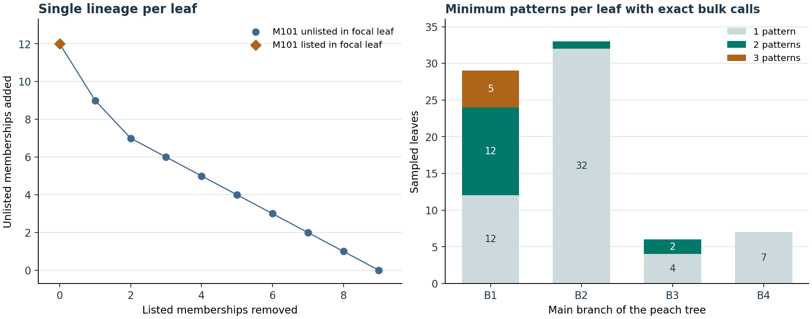

# Can the peach data distinguish a missed mutation from a mixture of cells?

Version 0.9.0 identified one unlisted marker in a particular peach leaf. Both ways to fit the catalogue with the fewest **additions** required M101 in specimen DHQ1_B1-1-L1. The result here is that the prediction switches when the cost of removing a reported membership falls below **three times** the cost of adding an unlisted one. Another explanation can keep all 3,600 bulk entries exactly as recorded if some leaves contain cells with different marker patterns. We calculated precisely which observations distinguish the two explanations. [Previous results](https://doi.org/10.5281/zenodo.24377898) · [Wang et al., source catalogue](https://doi.org/10.1371/journal.pbio.3000191.s019)

## The prediction in one leaf depends on the price of a missed call

Consider one irreversible mutation event per marker and one cellular lineage per leaf. A compatible table has nested or disjoint carrier sets. Write its loss as the number of added memberships plus λ times the number of removed memberships. The reference unit is one addition, and λ is positive. Repeating the calculation with a requirement that every marker retain at least one positive carrier gives the same threshold.

| Cost of one removal | What every minimum-cost fit says about M101 in L1 |
|---|---|
| Less than three additions | M101 is unlisted in every optimum. |
| Exactly three additions | Either state occurs among the optima. |
| More than three additions | M101 is listed in every optimum. |

At the switch point, 12 additions and no removals cost exactly as much as nine additions and one removal. With equal costs the minimum is **nine edits**. There are **768 distinct tables** attaining it. All leave M101 unlisted in L1. Of these, 256 put the two nonempty M71 and M101 sets in strict containment, and 512 make them disjoint. Requiring M101 to be listed at L1 costs at least eleven edits with equal weights. These costs are chosen assumptions. This study has no empirical estimate for λ, and counting optimal tables gives no odds of a genotype or mutation order. [Full sensitivity curve, mathematical proof and source data](edits/FRONTIER.md) · [Independent enumeration](edits/independent/TREE_ENUMERATION.md)

## What would have to coexist in the peach leaves?

Suppose each marker arose once and persisted on a common cellular lineage tree. Treat each bulk leaf as the union of its cells’ marker patterns, and assume every present marker is detectable. Under those assumptions, **20 of the 75 leaves must contain multiple marker patterns**. Fifteen require at least two, and five require at least three. All five are on branch B1. One explicit assignment simultaneously meets all 75 individual lower bounds, using 100 pattern occurrences across the leaves. This applies established minimum conflict-free row-split mathematics to the published peach data. The 100 counts separate occurrences of a pattern in each leaf. The number of actual cells, developmental founders and cell layers is unknown. [Proof, named leaves and complete witness](mixtures/ROW_SPLIT.md) · [Independent calculation from the original diagram](mixtures/figure_result.json)

Two leaves from shoot B1-1 distinguish what a bulk measurement and a single-cell measurement can establish.

- **L2 is the leaf that lists M71, M92 and M101.** Each marker has recorded carriers that the other two lack. Under complete bulk calls and single irreversible origins, the three markers must occupy separate cellular paths. An independently verified cell from L2 carrying both M71 and M101 would refute that combination of assumptions.
- **L1 is the neighboring leaf with the disputed M101 entry.** If exactly that one missing membership is added and every other bulk entry is kept, L2 can contain M71 and M101 on the same path. They can also remain separate. The two explanations require at least 99 and 101 signature occurrences, respectively, across the whole tree. Both bounds are attained. Measuring M101 in bulk L1 would answer a different question from measuring both markers in one L2 cell. Ji et al. had already assigned the markers to different groups from later samples of the tree. [One-missing-call analysis](mixtures/MISSING.md) · [Ji et al., Figure 3](https://doi.org/10.1371/journal.pgen.1011829.g003)

**Correction to version 0.9.1.** Ji et al.’s Table S7 reports a site-specific count for the original L1 leaf, whose whole-genome run is **SRR8183363**. At M101, row 120 records 57 reference and 2 alternate reads (2/59). Row 121 records 44 reference and 4 alternate reads (4/48) in the neighboring L2 leaf. The archived report overlooked these rows. The later targeted assay used a different leaf. The bulk counts leave the original L1 genotype, cellular co-occurrence and the relative cost of catalogue errors unresolved. [Native S7 correction](../transmission_timing/peach/S7_CORRECTION.md) · [Peach measurements](../transmission_timing/peach/PEACH.md) · [Original Table S7](https://doi.org/10.1371/journal.pgen.1011829.s021) · [Specimen and accession checks](sources/PEACH.md)

## A separate check in 185 grapevines

Tello et al. selected 56 markers in 50 Tempranillo vines and genotyped 135 additional vines. The two measurement methods agreed on all **2,800** original vine–marker combinations in the paired table. However, nine entries differ between that table and the genotype-class summaries at three marker sites, including five changes between homozygous and heterozygous states. We analyzed both presentations. For a pair of binary markers, observing all four possible state combinations would contradict a perfect unrooted tree for that pair. The test does not require knowing which state was ancestral. [Original study](https://doi.org/10.1093/hr/uhaf237) · [Workbook and comparison](grape/GRAPES.md)

Dropping those three sites gives **53 markers and 1,378 pairs** for which both presentations agree. Twelve pairs that appeared identical across the original 50 vines became distinguishable when the additional 135 were included. Each grew from two observed combinations to three. None showed all four. Thus, the extra vines resolved 12 previously indistinguishable marker relationships on this panel. Using all 56 markers gives 12 gains with class summaries and 68 with the first 50 specimen-level calls. Excluding the three discrepant sites recovers precisely the same 12 pairs under both presentations. The authors selected the markers for informativeness in the original collection. The comparison cannot establish a mutation date, a universal error rate or the first route to a heritable trait. [Source reconciliation and independent check](grape/GRAPES.md)

## What remains open for Mutation by Natural Dominance

TMD asks which route first produces a defined successful heritable outcome. Records from surviving leaves and cultivated vines show how measurement and sampling change the apparent relationships among mutations. They lack observations of competing routes through their first qualifying successes. A recent single-cell study in two *Arabidopsis* plants traced three founder lineages into branching tissues, illustrating the distinction between an organ and its constituent lineages. A 2026 grapevine germplasm preprint covers 547 accessions and measures standing variation across cultivars and wild material. Neither supplies a measurement of the two markers together in a cell from the peach L2 leaf or scores the separate frozen split-read prediction. [TMD formulation](https://github.com/maldonado-research/TMD/blob/b96446a969e066f4835fba0ce49412100a388343/research/FORMULATION_AND_NEXT_EMPIRICAL_TEST.md) · [Arabidopsis single-cell study](https://doi.org/10.1038/s41477-026-02264-1) · [Grapevine germplasm preprint](https://doi.org/10.64898/2026.07.31.742002) · [Frozen prediction](https://github.com/maldonado-research/TMD/blob/e752c59c78f8b0f6995c6fffc4f3dfbcd0e4bc4e/research/shared_misses/PREDICTION.md)

A loblolly pine study gets closer to a heritable outcome. Five of seven sampled field branches with abnormal growth yielded dwarf offspring. For family WB-10 the authors counted 78 dwarf offspring among 145, although the sample size alongside the genotyping platform was 120. Distinguishing phenotyped offspring from genotyped offspring preserves the reported 53.8% transmission fraction. The branches were selected after the phenotype was visible. The causal mutation and its first arrival time are unknown. [Pine sources and literature review](sources/LITERATURE.md)

Prepared 19 November 2026 Pacific with AI assistance. The analysis reuses published observations. The primary plant studies provide the measurements, and the release includes independent computational checks on both the peach and grapevine calculations.

## Reproduce

Run `bash replay.sh` from this directory with Bash, diff and Python 3.10 or later. It recalculates the stored results from the archived inputs and runs the small exhaustive checks. Individual source notes give the native workbook and accession checks. To redraw the figure with Matplotlib, run `python3 -B plot.py`.
