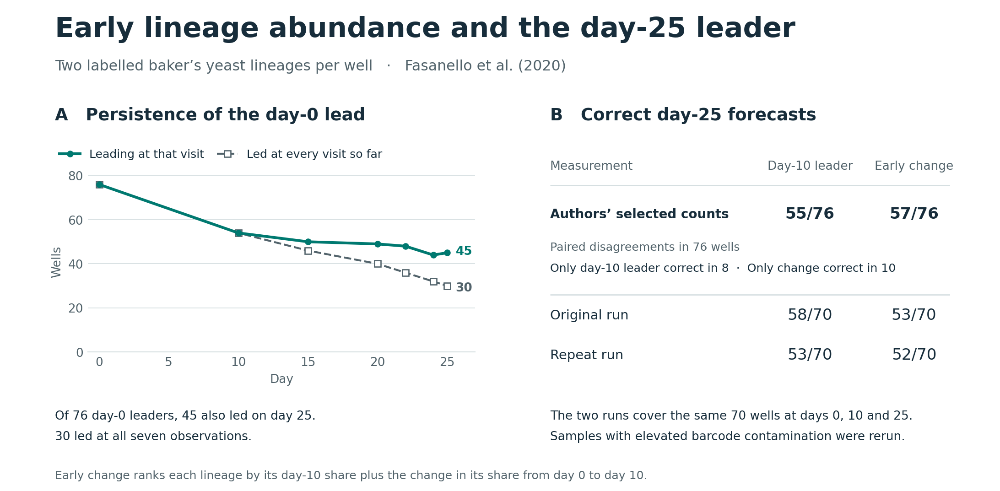

# Can early abundance predict the final leading lineage?

**Mutation by Natural Dominance · 19 November 2026 · Report and methods supplement 0.11.0**

In 76 baker’s yeast populations, the day-10 leader identified the day-25 leader in **55** populations. Projecting the early change in abundance identified it in **57**. The apparent advantage depended on how the endpoint was measured. Keeping both forecasts fixed and switching the final readout for just one pooled sample could give a tie or put the day-10 leader ahead. In two further yeast populations with hundreds of thousands of tracked labels, all three forecasting rules missed the final leader. [Fasanello et al.](https://doi.org/10.7717/peerj.10118) · [Levy et al.](https://doi.org/10.1038/nature14279)



## A forecast with a defined issue time

The preceding TMD report found that a later observation could change which marker qualified first. Here the source studies followed labels already present in a starting population. A label identifies a heritable group of descendants. The target is which label accounts for the most assigned reads at the final scheduled visit in the source table. The forecast never reads later abundances. The data were already public, and catalogue construction and laboratory quality control could use later information. The three forecast rules and two source studies were fixed before scoring. We added the repeat-library sensitivity, grouping checks and later-deposit comparison after inspecting the sources. [0.10.0 report](https://doi.org/10.5281/zenodo.24379400) · [Rules and named studies committed before scoring](https://github.com/maldonado-research/TMD/blob/f3f845323c41e2a346f705bf6289c03d10c4c661/research/lineage_forecasts/FORECAST.md)

Write the observed share of label i at the first visit as bᵢ and its share at the second visit as eᵢ. The three rules choose the largest bᵢ, eᵢ or 2eᵢ − bᵢ. The last score projects the change by one early interval and ranks the result. Both two-visit rules use the same information and forecast the same endpoint. Each forecast considers labels observed by issue time. An endpoint-only entrant can win. A tied forecast abstains, and only a unique forecast matching the unique endpoint leader scores a strict hit. [Full definitions](FORECAST.md)

## Two founding labels in each population

Fasanello et al. intended equal founding mixtures. Each of the 76 wells had two designated founding labels. The counts measure their relative representation in the sampled material. In the authors’ selected measurements the median starting leader held 68.7% of assigned reads. The design, sampling noise and label measurement leave the true starting proportions uncertain. Day 25 corresponded to about 250 generations under standard conditions, with a range of about 200–300 across the treatment schedules. We used calendar days to compare wells. All 76 had a measurable baseline, early visit and endpoint, with unique predictions and unique endpoint leaders. [Source and reconstruction](fasanello/SOURCE.md)

| Rule | Visits used | Strict hits at day 25 |
|---|---|---:|
| Baseline leader | Day 0 | 45/76 (59.2%) |
| Early leader | Day 10 | 55/76 (72.4%) |
| Early change | Days 0 and 10 | 57/76 (75.0%) |

Both two-visit rules succeeded in 47 wells. Early change alone succeeded in ten, the day-10 leader alone in eight, and both missed in eleven. A fair guess between the two observed labels would average 38 hits in 76 wells. This reference describes the guessing rule. Shared founders and uneven baseline measurements complicate any comparison with biological drift. Of the 45 baseline leaders that also led at the endpoint, 30 stayed first at every sampled visit. The other 15 lost the observed lead at least once and recovered it by day 25. [Counts and per-well predictions](fasanello/pair_results.json) · [Vector figure](lineage_forecasts.svg)

Founding labels recurred across wells. After resolving the source’s identifiers there are 38 distinct label pairs, or 44 when strain ploidy distinguishes pairs. Among eleven ploidy-specific pairs represented more than once, five produced different endpoint leaders across wells. Even an assignment chosen after seeing all endpoints must miss six wells if restricted to one predicted label for each ploidy-specific pair. The same label can therefore accompany different outcomes within this archive. The data combine conditions, sampling and shared processing. A causal effect of changing conditions needs additional controls. [Source identifiers](fasanello/SOURCE.md) · [Grouping sensitivity](fasanello/pair_results.json)

## Can the two extra successes distinguish the rules?

The authors reprocessed selected samples after observing elevated barcode contamination. They used separate aliquots collected at the same visit and preferred the library with lower measured contamination. Seventy wells have both an original and a repeat measurement at all three required visits. The two day-25 measurements selected different leading labels in **17 of those 70 wells**. These technical repeats measure the same physical populations. Their disagreement rate applies to this selected set. [Source methods and matched results](fasanello/TECHNICAL_REPEATS.md)

Keep the forecasts from the authors’ selected early libraries fixed and vary only the final measurement. Within those 70 wells the day-10 leader scored 53 hits to early change’s 52 against the repeat endpoints. Against the original endpoints the scores were 54 and 39. Across every combination of the two observed endpoints in these same 70 wells, the day-10 leader won by **at least one hit**. The six other wells contributed two early-leader and five early-change hits against their selected endpoints. Their three-hit difference shifted the overall comparison. [Per-well enumeration](fasanello/endpoint_envelope.md)

The laboratory processed multiple wells in each pool. We also respected that shared measurement by switching the final library for all wells in a pool together. The 70 complete wells occupy seven pools. We kept the six wells in the eighth pool on their selected endpoints. For each paired pool p, let dₚ(r) be the number of correct change forecasts minus correct day-10 leader forecasts using endpoint library r. Under independent **choices** of library across pools, the possible total differences are precisely all sums of one observed dₚ per pool, plus the fixed contribution of three. The extrema are the sums of the minima and maxima. This is a finite sensitivity calculation, requiring no probability model for reads or independence of biological outcomes.

All 128 pool assignments were enumerated. They yielded every even difference from **12 fewer to two more** hits for early change. Switching only pool S14 from the preferred repeat to the original gave a **54–54 tie**. Switching only pool S12 gave **57 early-leader hits against 53 early-change hits**. The originally selected measurements remain the primary comparison. These alternatives quantify how much the comparison depends on which recorded library supplies the endpoint. They leave the accuracy against true cell counts open. [Verified pool memberships and counts](fasanello/TECHNICAL_REPEATS.md) · [Exact enumeration](fasanello/pool_results.json)

## Many lineages in the same experiment

Levy et al.’s two public figure-data tables each have 494,066 anonymous rows. They share the same recorded baseline column. The second and final visits are generations 16 and 112 in the first table and 8 and 96 in the second. These are the ends of the original figure-data windows. Each forecast was issued and evaluated within its own table.

| Population | Final sampled generation | Chosen row under all three rules | Final rank of chosen row | Eventual leading row | Its reads at baseline, early visit, final visit |
|---|---:|---:|---:|---:|---|
| E1 | 112 | 262 | 91 | 3,730 | 272, 288, 2,207,149 |
| E2 | 96 | 262 | 48 | 1,379 | 2,279, 627, 1,270,438 |

All three predictions and both endpoints were unique. Each forecast picked a label that finished high in the ranking, yet another label led by the endpoint in each population. In E1, the eventual leader first appeared at the top of the sampled ranking at generation 80. The early measurements had given it ranks 277,382–277,962 at baseline and 93,224–93,759 at generation 16, including count ties. A Stanford course copy independently reproduces all 5,928,792 E1 counts and labels each row by its position in the primary file. It supplies another check on E1. The two original populations shared a starting pool and each contributes one endpoint. The number of barcode rows is not a count of independent forecast trials. [Primary results and source links](levy/levy_result.json) · [Stanford comparison](levy/STANFORD_SOURCE.md)

A later deposit for the same two populations reports technical counts separately. At the shared baseline, **3,145 rows have a count of one in the 2015 figures and zero across all five baseline columns in the later deposit**. At the other overlapping visits, summing the technical columns agrees with all 9,881,320 figures in the earlier tables. With a positive-count eligibility rule, the later deposit gives 490,921 eligible baseline labels. By the second visit the eligible counts rise to 491,342 and 491,240, respectively. Using those counts changes none of the three forecasts. This check identifies an explicit disagreement in how baseline presence is recorded. A count of zero gives no certainty that a label was absent from the population. The extended records show the same observed endpoint leaders leading at generations 248 and 208. [Later source study](https://doi.org/10.1038/s41559-018-0758-1) · [Cross-deposit results](levy/deposits_comparison.json)

## What this tests for TMD

The TMD formulation asks which successful mutational route appears first under defined conditions. A founding barcode can persist through several subsequent changes, and the largest label at a sampled endpoint can descend from a lineage that started early or late. These two studies directly test predictions about the later abundance of identified labels. The two-label results show why a claim that one prediction rule outperforms another needs to survive how the endpoint is read. The many-label results show why a prediction should specify whether finishing near the top counts as success. Here the frozen criterion required first place. [Original TMD formulation](https://github.com/maldonado-research/TMD/blob/f14d1a086dac09f1f884a40743a75b40295f3df3/research/FORMULATION_AND_NEXT_EMPIRICAL_TEST.md)

A 2025 study, Doblin, uses time-series data to infer dominant lineages and compares inferred identities with known histories in simulations. The 2026 barbieQ study tests barcode proportion and occurrence across sample groups and explicitly models sample-to-sample variability. Both approaches inform the distinction between reconstructing a history from all observations and scoring a prediction made by a particular visit. Our comparison fixes the issue time and counts successes against the observed endpoint. A direct test of TMD’s first-route prediction still needs route identities and comparable observations of the first qualifying events. [Doblin](https://doi.org/10.1093/bioinformatics/btaf555) · [barbieQ](https://doi.org/10.1093/bioinformatics/btag397)

## Reproduction

Use Python 3.11 or later. From this folder, run `bash replay.sh` for the included Fasanello counts, archive-selected forecasts and repeat-measurement analyses. The large Levy inputs remain available from their primary repositories. The source commands below verify file identities and recalculate both population scores and the baseline discrepancy. The included JSON records the results. The analysis and writing were prepared with AI assistance for Ricardo Maldonado’s TMD project. [Two-label input](fasanello/SOURCE.md) · [Technical repeats](fasanello/TECHNICAL_REPEATS.md) · [Many-label source guide](levy/SOURCES.md)

```sh
python3 -B forecast_figure.py --out /path/to/figure-output
python3 -B levy/score_levy.py MOESM90.csv MOESM93.csv | diff - levy/levy_result.json
python3 -B levy/compare_levy_deposits.py MOESM90.csv MOESM93.csv SD1.csv SD2.csv | diff - levy/deposits_comparison.json
```
