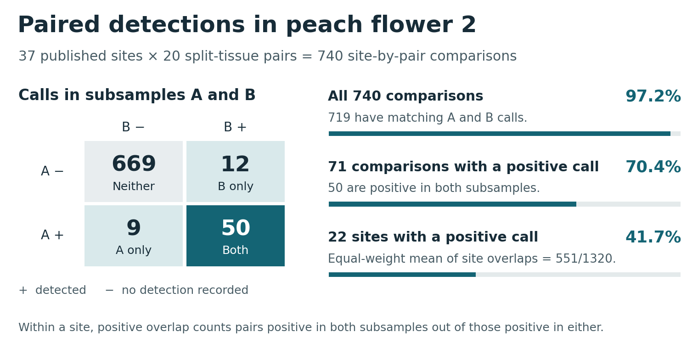

# What can paired observations tell us about mutation records?

The three-archive comparison found that Mws exceeds Aws among five selected wrinkly coculture endpoints if the published annotations are held fixed. Two questions follow. How well do those family annotations distinguish the paired phenotypes? How much repeatability can an observed mutation call establish? We examine the first question in the original Howells collection and the second in Ji et al.’s peach flower study. The studies have different units and supply separate results. [Earlier archive comparison](../archived_rank_robustness/README.md) · [Howells et al.](https://doi.org/10.1111/1462-2920.70061) · [Ji et al.](https://doi.org/10.1371/journal.pgen.1011829)

## A family-only rule can distinguish at most 12 of 18 selected endpoints

The Howells archive has one wrinkly and one smooth endpoint per retained parent population. Six of the nine pairs have identical recorded categories across their two endpoints. Two pairs share a Wsp annotation, one shares Mws, and three have no matched focal annotation on either endpoint. A rule that sees only the category must give both members of each of these six pairs the same prediction. It must therefore make at least six errors. In the other three pairs only the wrinkly member carries a matched family annotation, so the simple rule “matched predicts wrinkly, unmatched predicts smooth” attains the bound. The highest possible accuracy on these records is **12/18**, or two thirds. Giving the rule the recorded culture context as well leaves that ceiling at 12/18. [Source data](https://doi.org/10.6084/m9.figshare.28340420.v1) · [Paired tables](paired_result.json)

| Input available to the rule | Best possible on these same records | Leave one parent pair out, majority rule |
|---|---:|---:|
| Family category, including unmatched | 12/18 (66.7%) | 11.5/18 (63.9%) |
| Family category and culture context | 12/18 (66.7%) | 11/18 (61.1%) |

The first column lets a deterministic rule choose the more frequent phenotype in every input category using the full archive. If a category contains w wrinkly and s smooth records, its largest number correct is max(w, s). Sum over categories for the ceiling. The last column learns that choice again after removing **both** records of each test parent. A tied or previously unseen category gets half credit per test record, the expected score of a fair random guess. The nine pairs were deliberately balanced by phenotype and analyzed retrospectively. Neither number estimates population prevalence or prediction accuracy for unseen studies. [Calculation](paired_diagnostic.py) · [Exhaustive check over all rules](verify_paired.py)

### How many annotation changes could alter the rank?

This is a sensitivity analysis on recorded labels. First assign each unresolved parent any allowed label without charge. A paid edit then changes one parent's attributed label. Under the **removal** rule an edited focal call contributes to Other. Under **reassignment** it may contribute any single class, including Other. The minimum costs below allow a change at any represented parent. The same minima occur when paid changes are restricted to originally single-label parents on these three rosters. No observed error rate is assumed.

| Archived contrast | Removal to tie | Removal for strict reversal | Reassignment to tie | Reassignment for strict reversal |
|---|---:|---:|---:|---:|
| Historical, Aws over Mws (26 parents) | 2 | 3 | 1 | 2 |
| Matela, Aws over Mws (50 parents) | 1 | 2 | 1 | 1 |
| Howells coculture, Mws over Aws (5 parents) | 1 | 2 | 1 | 1 |

In Howells coculture, assigning the unmatched record to Aws gives **Wsp 2, Aws 1, Mws 2**. Removing one Mws attribution ties Aws and Mws. Reassigning it to Aws puts Aws ahead of Mws. Restoring the *full* earlier order Wsp > Aws > Mws requires changing both Mws attributions. Removing both gives **2, 1, 0**. With just five parents, a strict three-class ordering with at least one Mws would need at least six parents (3 + 2 + 1). One Mws-positive parent has a matched family on its smooth comparator and the other does not. Editing only one of those two groups cannot restore the full order. The smooth comparators establish neither which annotations were incidental nor the rate of misattribution. [Howells annotation receipt](../archived_rank_robustness/howells_receipt.json) · [Exact edit calculations](attribution.py)

For a pairwise comparison, score a vote for the leader as +1, the challenger as −1 and any other category as 0. Take each parent's smallest score among its free choices. Their sum is the starting minimum margin. Allowing an edit gains the difference between the free minimum and the smallest score after an edit. With a budget of k edits, subtract the k largest gains for the sharp lower endpoint. Each parent can attain its chosen minimum independently in this calculation. To check exact ties, the program also retains the least cost for every attainable signed difference. This matters when zero lies between attainable endpoints but cannot itself be reached. A second calculation tracks joint count triples and checks 192 directed pairwise results, the eight coculture joint-order minima and their associated examples. [Independent verifier](verify_attribution.py)

## A peach flower shows why the denominator matters for repeatability

Ji et al. reported 719 agreements among 740 comparisons from 37 previously identified candidate sites across 20 split tissues of peach flower #2. We joined the reference and alternative states in Table S2 to every paired call in Table S5. The ordered counts below distinguish which repeat had a positive call. [Study and sampling description](https://doi.org/10.1371/journal.pgen.1011829) · [Table S2](https://pmc-oa-opendata.s3.amazonaws.com/PMC12370204.1/pgen.1011829.s016.xlsx) · [Table S5](https://pmc-oa-opendata.s3.amazonaws.com/PMC12370204.1/pgen.1011829.s019.xlsx)

| Split A / split B | B positive | B reference | Total |
|---|---:|---:|---:|
| A positive | 50 | 9 | 59 |
| A reference | 12 | 669 | 681 |
| Total | 62 | 678 | 740 |

- **Across all comparisons**, (50 + 669)/740 = 97.16% agree. The paper prints 97.1%. Its numerator and denominator reproduce exactly.
- **Among comparisons positive in either split**, 50/71 = 70.42% are positive in both. Direction matters if one split defines the list. Split B recovers 50/59 of A's positives, and A recovers 50/62 of B's.
- **Giving each detected site equal weight**, the mean fraction called by both splits among comparisons positive in either is 551/1320 = 41.74%. Fifteen of the 37 candidate sites have no positive in these split tissues. Their site-specific overlap has zero denominator. Of the 22 with at least one positive, only 11 have any double positive.
- **Two widely detected sites supply 37 of the 50 double positives.** These two sites have a call in at least one split for every one of the 20 tissues. Removing them leaves 13 double positives among 31 comparisons positive in either split (41.94%). This is a descriptive check chosen using observed detection breadth. It does not define a new independent sample.



For site j, let Iⱼ count tissues positive in both splits and Uⱼ count tissues positive in either. The pooled fraction sums the Iⱼ and divides by the sum of Uⱼ. It therefore weights each site's overlap Iⱼ/Uⱼ in proportion to Uⱼ. The equal-site result instead averages those fractions over the 22 sites with Uⱼ > 0. The 28.68 percentage-point difference between the two summaries arises on exactly the same calls. Each answers a different question about this flower. [Aggregate receipt and site histogram](peach_receipt.json) · [Source replay](replay_peach.py)

The authors used evidence elsewhere in the flower to interpret the 21 discordances, assigning 11 to their false-negative category and 10 to their false-positive category. Those labels have a different meaning from the observed split directions, 9 A-only and 12 B-only. Candidate discovery used the wider flower screen, including split samples. No independent census supplies the true states among double-reference pairs or sites missed altogether. The 740 comparisons share both tissues and sites within one flower. These data support descriptive repeatability calculations and leave true sensitivity and the biological mutation rate unestimated. [Study methods](https://pmc.ncbi.nlm.nih.gov/articles/PMC12370204/) · [All four source counts verified](verify_peach.py)

## Consequence for the hypothesis

The Howells result limits what an annotation can say about a selected phenotype, even with perfect arithmetic and a known parent. The peach result shows how often agreement can come from two reference calls, and how widely observed sites can dominate a repeatability score. Neither study measures the independent mutation-supply and recovery terms needed to test the TMD fixed-axis prediction about successful routes. A discriminating future archive would specify its parent population, label rule, weights and independently assessed outcomes before scoring and retain missing and unassigned outcomes in the accounting. [TMD model and empirical prediction](../FORMULATION_AND_NEXT_EMPIRICAL_TEST.md)

## Reproduce

From the repository root, Python 3.10 or later runs the following offline checks. The paired input is the verified aggregate receipt from the previous archive comparison.

```sh
audit=research/paired_evidence
input=research/archived_rank_robustness/howells_receipt.json
python3 -B "$audit/paired_diagnostic.py" "$input" | diff - "$audit/paired_result.json"
python3 -B "$audit/verify_paired.py" "$input" "$audit/paired_result.json"
python3 -B "$audit/verify_attribution.py"
python3 -B "$audit/verify_peach.py"
```

To print the complete edit results, run `python3 -B research/paired_evidence/attribution.py`. The peach source replay requires openpyxl. Download Tables S2 and S5 from the links above, then run the commands below. Rendering the optional figure uses Matplotlib.

```sh
python3 -B "$audit/replay_peach.py" /path/to/pgen.1011829.s016.xlsx /path/to/pgen.1011829.s019.xlsx | diff - "$audit/peach_receipt.json"
python3 -B "$audit/peach_figure.py"
```

Targeted searches covered paired phenotype archives and independent detection checks in recent plant studies. A September 2026 Arabidopsis study compared six assemblies of two plants against underlying data. Its per-assembly error counts concern sequence assembly and use a different denominator from Ji et al.’s split-tissue calls. The two datasets have no shared biological denominator for pooling. [Arabidopsis centromere study](https://doi.org/10.1038/s41586-026-11046-w)

Prepared 18 November 2026 Pacific. Replays and exact enumeration were checked independently within the project. The numerical results are retrospective analyses of the cited studies. Source authors retain credit for their original observations.
