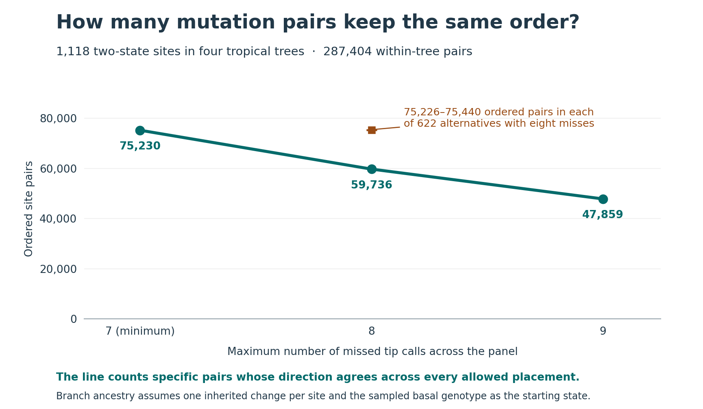

# How often can we tell which mutation came first?

**Mutation by Natural Dominance · Report and methods supplement 0.13.0 · 21 November 2026 Pacific**

A pedigree can put most pairs of changes in order and still leave the first change ambiguous. In one published yeast study, the recorded daughter samples ordered **3,153 of 3,605 pairs** on the same path, yet only **one of eight paths** had a unique candidate at the first recorded index. In four tropical trees, allowing one additional missed leaf call left about 75,000 pairs ordered in every reconstructed history, but changed *which* pairs could confidently be ordered. These results narrow the evidence needed for TMD's prediction of the first successful new mutation. [Yeast pedigree measurements](kennedy/README.md) · [Tree reconstruction](shorea/panel_budget/README.md) · [Original TMD formulation](https://github.com/maldonado-research/TMD/blob/f14d1a086dac09f1f884a40743a75b40295f3df3/research/FORMULATION_AND_NEXT_EMPIRICAL_TEST.md)

## A mutation assigned to a division

Kennedy et al. studied successive daughters of baker’s yeast mother cells. The seven named lineages produced eight recorded paths because one lineage branched. The source assigns 237 maternal changes. For 233, the published counting convention gives a single daughter index. Four first appear together after one daughter was unavailable, leaving two possible division slots. Of 3,605 within-path pairs, 3,153 had disjoint windows, 446 shared a single index and six lay within the same two-slot window. The earliest recorded bins contained **2, 3, 2, 2, 3, 1, 7 and 7** candidate changes. These are earliest assignments among the included calls. Two calls inherited from the shared history are distinguished from new calls on the second limb. [Kennedy et al.](https://doi.org/10.1371/journal.pgen.1005151) · [Source windows and independent sample support](kennedy/README.md)

The actual measurements show why “first” needs a definition. The authors illustrate how a replication error can precede the first positive daughter by two divisions. When only directly sampled positive columns and their predecessors are used, 219 sites have a single detection index, eleven span two potential indices and seven first appear at a branch boundary. Twenty-four source-counted changes appear in only the final sampled clone column on their path. Requiring support in two sampled columns retains 213 changes, of which 2,602 of 2,993 within-path pairs have disjoint assigned windows. The original workbook, model input and supplementary summary use different sets of divisions. Their totals are documented separately in the replay. [Source-table cross-check](kennedy/results.json)

Dowsett et al. used multiple descendants to assign replication errors to particular mother-cell divisions in another set of yeast lineages. We matched all **13,801 entries** in the original change list to 50 division totals across seven pedigrees. Among pairs in the same pedigree, **13,374,707 of 15,307,308 (87.37%)** came from distinct ordered divisions. The other **1,932,601** pairs share a division and the workbook supplies no order inside it. Giving each pedigree equal weight yields 84.32%. Comparable percentages in the two yeast studies describe different timing assignments in selected mutation-prone cells. The denominators count pairs sharing cells and changes. [Dowsett et al.](https://doi.org/10.1038/s42003-020-01544-6) · [Exact pair counts and original workbook verifier](divisions/README.md)

## Which pairs on a tree keep their order?

Satake et al. recorded genotypes at seven leaf tips and a basal cambium sample in each of four tropical trees. We used independently measured physical distances to recover the sampled branch geometry. The F/S prefixes in the genotype worksheet conflict with those in the source figure and distance tables. Reconstructing all 28 genetic distances per individual matched **112 of 112** entries after correcting the cross-sheet correspondence. Of 1,136 sites, 1,118 had two measured genotypes and 18 had three. We used the two-state sites for the branch-placement test. [Satake et al.](https://doi.org/10.7554/eLife.88456) · [Workbook, block mapping and placement derivation](shorea/README.md)

The interpretation assumes one inherited change per site on the anatomical tree, with the basal sample supplying the starting genotype. A candidate branch has to include every observed tip carrying the changed genotype. Each additional descendant tip reported with the basal genotype costs one hypothetical missed call. A complete assignment selects a branch for every site. A pair has a guaranteed direction only if **every** complete assignment within the stated allowance puts one site on an ancestral branch of the other. This condition leaves order within a branch and time across different limbs open. The calculation treats each tissue’s reported genotype as one state. Agreement with the anatomical model leaves the underlying cellular lineages and any tissue mosaicism unresolved.

| Maximum missed tip calls across all 1,118 sites | Specific pairs whose ancestral order is guaranteed |
| --- | ---: |
| 7, the minimum compatible with the complete panel | 75,230 |
| 8 | 59,736 |
| 9 | 47,859 |

There are 287,404 possible within-tree pairs. Seven misses yield one complete placement. At exactly eight there are 622 alternatives, each containing **75,226–75,440** ancestrally ordered pairs. Across those alternatives and the minimum placement, only **59,736 specific pairs** retain a guaranteed direction. Allowing that eighth call costs **15,494** previously guaranteed pair identities. Each alternative changes a much smaller set. These are limits of the observed pattern under explicit assumptions. Seven is a mathematical minimum for this model. It is not an estimate of the number of actual genotyping errors. One tree contributes 252,405 of the pairs. [Independent workbook calculation and per-tree totals](shorea/panel_budget/README.md)

A separate check holds the roster to the 1,111 sites compatible with exact calls. Those sites have 72,219 forced pair orders. Allowing one miss per site on that identical roster reduces the number to 56,745. Calendar time and the relation of the anatomical branches to actual stem-cell lineages remain open. Tomimoto et al.’s 2026 preprint models stem-cell dynamics using these same trees. Its results provide context from the same biological specimens. [Per-site calculation](shorea/README.md) · [Tomimoto et al.](https://doi.org/10.64898/2026.04.02.716038)

## When a second carrier becomes observable

Lindsay et al. studied spontaneous mutations in mouse families. In the two largest pedigrees, the source workbook lists 391 changed nucleotide rows. Applying the authors’ nearby-change grouping gives **388 mutation events**. From explicit offspring identities, **69 events** occurred in at least two distinct siblings. Fifty-three of those 69 lacked a detectable signal in the sampled parental somatic tissues. The counts of changed bases and grouped mutation events differ by one for the sibling-shared group. [Lindsay et al.](https://doi.org/10.1038/s41467-019-12023-w) · [Source grouping and denominator check](mouse/README.md)

Seventeen of the 69 shared events already had two observed carriers in their first positive litter. For **52 of 69 (75.4%)**, a second carrier came from a later litter. Under a shared-origin interpretation, the parental lineage carrying the variant predated its transmission to both offspring. The birth order of the observed carriers bounds when that *evidence* became available. It dates neither the molecular event nor the laboratory measurement. Testing just the 20 offspring in the two families’ genome-wide discovery sample shows 23 shared events. Additional sibling measurements reveal all 69 on the same discovered roster. This comparison is conditional on the original discovery sample and the subsequent genotyping. [Litter-level evidence](mouse/README.md)

Plant tissues supply a complementary check. In Schmitt et al.’s study, 17 of 46 positive branch–marker combinations in *Dicorynia* cotyledons lacked a corresponding leaf call on the same branch. The result was 10 of 24 for *Sextonia* embryo sacs. Requiring at least 20 total reads and three alternate reads in fruit gave 15 of 42 and 10 of 24, respectively. Each marker had already been found elsewhere in the parent. An unlisted leaf call has uncertain sensitivity, and fruit tissues can contain material from more than one source. The authors discuss both tissue origin and sampling. These data quantify gaps between two observations of the same branch. Establishing heritable transmission or dating its origin requires further evidence. [Schmitt et al.](https://doi.org/10.1073/pnas.2313312121) · [Matched branch and source checks](fruit/README.md)

## What this changes for the hypothesis

A test of TMD's first established route must name the event to be predicted. The first DNA change, first inherited genotype, first measured carrier and first lineage to pass an establishment threshold can occur at different times. The yeast observations show the limits even of division-resolved data. The tree results show that thousands of apparent orders can coexist with uncertainty about particular pair identities. The mouse records show how later sampling can establish earlier inheritance. None of the five datasets records every attempted route and its subsequent fate under a common establishment definition.

For a future first-route forecast, preserve the set of plausible earliest routes for each observation unit. A recorded unit can identify a unique first candidate, exclude a prediction, or leave it possible alongside other routes. Score those outcomes separately under a stated observation model. In the 2015 yeast pedigrees, roughly 87% of pairs could be ordered, but seven paths still had multiple candidates at their earliest assigned index. [TMD research question](https://github.com/maldonado-research/TMD/blob/f14d1a086dac09f1f884a40743a75b40295f3df3/research/FORMULATION_AND_NEXT_EMPIRICAL_TEST.md) · [Earlier founder-abundance benchmark](https://doi.org/10.5281/zenodo.24409045)

## Reproduction

From this report folder, run `bash replay.sh` with Python 3.11 or later. The script checks the included anonymous summaries and tables, the original tropical-tree workbook, and the independently computed branch-placement results. The five source guides give the original downloads, versions, attribution and native-file verification commands. The figure can be regenerated with `python3 -B plot_resolution.py` and Matplotlib. This is an exploratory reanalysis of published data. The checks and report were prepared with AI assistance for Ricardo Maldonado's TMD project.
