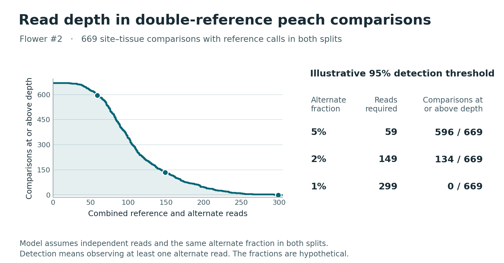

# What can two negative observations rule out?

**The published peach read counts let us measure the evidence behind 669 pairs of negative calls.** Across those comparisons the study recorded 74,030 reference-read observations and zero alternate reads. The depth available to check any *one* candidate site in *one* tissue ranged from 21 to 294 reads across the two splits. The same data also show how unevenly positive reads can fall between splits. In 64 comparisons with at least two alternate reads, all alternate reads occurred in just one split 14 times. If alternate reads occupied random positions among the recorded reads, the expected count would be 3.18. This is a check on a measurement assumption in one flower. The counts leave open how many of the 669 double-reference comparisons contained a true variant. [Ji et al., 2025](https://doi.org/10.1371/journal.pgen.1011829) · [Earlier paired-call analysis](../paired_evidence/README.md) · [Verified depth totals](depth/depth_receipt.json)

A separate tropical-tree archive supplies a real example of the distinction between follow-up and biological transmission. The published Methods select 124 candidate sites in one tree and 36 in the other. Supplementary Note S9 gives 117 and 36 sites in the final assay panels. Archived positive flags occur at 23 and 9 sites across fruit tissues, including 20 and 8 with a flag in a row labelled “embryo sac.” These are successive measurement stages. Each has its own denominator. [Tropical-tree source audit and reproduction](fruit/SCHMITT_SOURCE.md) · [Schmitt et al., 2024](https://doi.org/10.1073/pnas.2313312121)

## What did the peach tables actually measure?

Ji et al. split 20 tissues of peach flower #2 into two subsamples and reported calls for 37 sites already identified in Flower #2 during the discovery screen. We joined each of the 1,480 individual site-by-subsample records across the reference and alternate states (Table S2), counts (S3), categorical calls (S5) and reported percentages (S6). All 1,359 categorical reference calls had zero recorded alternate reads, and all 121 categorical positives had at least one. All of the comparisons had positive combined reference-plus-alternate depth in each half. Five marked percentages in S6 were treated separately in one regression by the authors. Their zero versus positive status agrees with the underlying counts. S6 summarizes the same reads. The paper also reports a separate validation for four branch mutations outside this 37-site frame. These records leave the true state of the 669 double-reference comparisons open. [Primary study and supplementary tables](https://pmc.ncbi.nlm.nih.gov/articles/PMC12370204/) · [Table S3, underlying counts](https://pmc-oa-opendata.s3.amazonaws.com/PMC12370204.1/pgen.1011829.s017.xlsx) · [Table S6, percentages](https://pmc-oa-opendata.s3.amazonaws.com/PMC12370204.1/pgen.1011829.s020.xlsx)

Suppose, for illustration, that the D recorded reads for a particular site–tissue comparison are independent, and that every read in its two halves has the same probability p of being alternate. The probability of observing zero alternate reads is then (1 − p)ᴰ. At p = 1%, this probability is 80.97% at the shallowest depth, 36.60% at the median depth of 100, and 5.21% at the deepest depth. None of the 669 comparisons reached 299 reads, the depth that would yield a 95% chance of seeing at least one alternate read under this model. The corresponding depth criteria at 2% and 5% were met by 134 and 596 comparisons, respectively. These are per-comparison calculations at a hypothetical read fraction. Selecting these comparisons for their zero counts also prevents interpreting the thresholds as a joint confidence statement about all 669. The archive supplies neither a count of independent original molecules nor a common biological fraction across tissues. Combining all 74,030 site-level observations into a single depth would answer a different question. [Depth histogram](depth/depth_receipt.json) · [Exact threshold counts](depth/depth_scenarios.json)

## Does random allocation between splits explain the positive records?

For each site–tissue comparison, keep the two observed split depths, a and b, and the observed total of k alternate reads. As a benchmark, assign the k alternate labels uniformly to k of the a+b available read positions. For k ≥ 1 the probability that all alternate reads fall in one split is

$$
q(a,b,k)=\frac{\binom{a}{k}+\binom{b}{k}}{\binom{a+b}{k}}.
$$

A binomial coefficient is zero if its upper argument is smaller than k. Summing q across the included comparisons gives the expected number positive in only one split. The expectation uses no fitted common alternate fraction across sites and needs no assumption that different comparisons are independent.

| Recorded alternate reads across both splits | Site–tissue comparisons | Observed positive in one split only | Expected under uniform allocation |
|---|---:|---:|---:|
| Exactly one | 7 | 7 | 7.00 |
| Two or more | 64 | 14 | 3.18 |
| All positive comparisons | 71 | 21 | 10.18 |

With one alternate read, one-sided detection is inevitable. Among comparisons with two or more the observed excess is 10.82. Consequently the archive gives a reason to question the simple allocation assumption even on detected sites. Unequal composition in the two halves, dependence among reads, technical variation and candidate selection could contribute. The comparison cannot apportion those explanations or measure a false-negative rate for the double-reference sites. All 71 positive comparison profiles are available without sample or site identifiers. An independent calculation reproduced the expectation for each profile and checked the formula against 150 small enumeration cases. [Aggregate profiles](allocation/allocation_profiles.json) · [Results](allocation/read_allocation_result.json) · [Independent calculation](allocation/verify_read_allocation.py)

## Can the categorical records alone count shared misses?

Even assuming every positive call is genuine and each pair shares one underlying binary state, the 50 double positives, 21 single positives and 669 double references allow **any integer from 0 to 669** truly positive comparisons missed by both splits. For every such integer there is a compatible assignment among the double-reference cells.

A more restrictive calculation shows how easily a precise-looking bound can depend on the grouping. In a group, write I for double positives, A and B for the two kinds of single positives, and h for true positives among its double references. Impose the illustrative inequality I × h ≤ A × B on a completed table. Applied once to the pooled counts, it gives 50h ≤ 9 × 12 and h ≤ 2. Applied separately to 20 tissue tables, the sharp maximum is 3. Applied separately to the 37 site tables, it is 510. In 26 sites with no double positive, the inequality places no restriction on 508 double-reference comparisons. The data give no reason to adopt any of these restrictions. They illustrate the risk of treating pooled agreement as a calibrated limit on shared misses. [Assumptions, attainable counts and proofs](dependence/BOUNDS.md) · [Related capture–recapture literature](https://doi.org/10.1093/jssam/smac031)

**The tissue pairings still carry real information about the pattern of calls.** Keep whole B-subsample profiles intact and reassign their tissue labels within each organ type. Of 3,483,648,000 possible assignments, 6,912 attain the observed overlap of 50 double positives, the largest possible. Restrict alternatives to pieces of the same indexed physical organ and only 48 assignments remain. Four attain 50, and the mean is 48. These fractions describe the finite set of label assignments and its dependence on anatomy. The study design supplies no random reassignment distribution for inference. An exact enumeration and a separate subset calculation agree. [Pairing results](alignment/alignment_receipt.json) · [Source tissue labels, Table S1](https://pmc-oa-opendata.s3.amazonaws.com/PMC12370204.1/pgen.1011829.s015.xlsx)

## Why shared misses matter for TMD

TMD asks which route first produces a successful heritable outcome in a given setting. Consider the simplest observation model in which each unit has one true first route, recorded labels are correct and recovery can differ by route. For routes A and B, the ratio of their probabilities among recorded events then equals the true first-route probability ratio multiplied by the ratio of their recovery probabilities (provided the denominators are positive). A more frequently recorded route can therefore owe its lead to recovery. The peach comparison tests one way of modeling recovery after material has been split. It supplies no route-specific recovery probability for the biological TMD test. The same selection issue appears in a 2026 sweet-orange study, where additional libraries recovered 49–69% of the original leaf-specific calls across comparisons. Its denominator comprises calls already made in the first library. [TMD formulation](../FORMULATION_AND_NEXT_EMPIRICAL_TEST.md) · [2026 primary-source review](SEARCH.md) · [Sweet-orange study](https://doi.org/10.1093/plcell/koag288)

## A prediction for the next independent archive

The peach result suggests a narrow observation hypothesis. **In an independently ascertained set of split plant tissues, positive reads will fall in just one half more often than random allocation predicts at the recorded depths and alternate totals.** We fixed the score and the rule for choosing the next archive before evaluating that archive. A zero or negative score would fail the directional prediction. This is a prospective check on how observations are generated. TMD’s biological prediction about the first successful evolutionary route also needs independent information on mutation supply, time and recovery. [Frozen scoring rule and eligibility](PREDICTION.md) · [TMD biological formulation](../FORMULATION_AND_NEXT_EMPIRICAL_TEST.md)

Prepared 19 November 2026 Pacific. This GitHub research checkpoint extends the [0.8.1 Zenodo report](https://doi.org/10.5281/zenodo.24356808). Primary studies retain credit for the measurements. The source comparisons and calculations were conducted with AI assistance and independent internal computational checks. [Reproduce the analyses](REPRODUCE.md)
