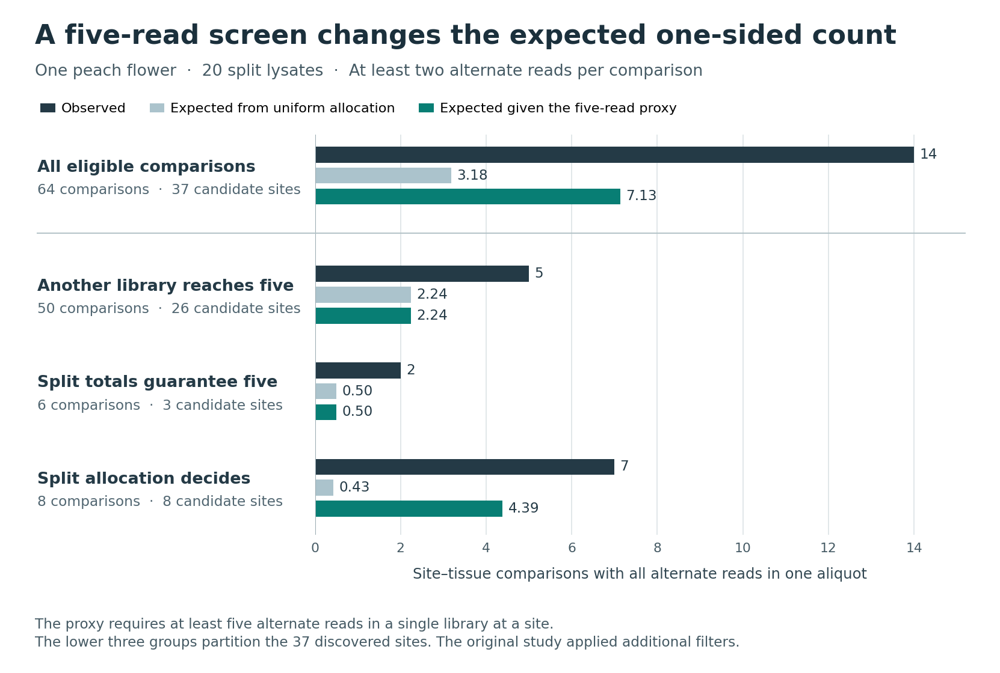

# Why a mutation discovery screen can make two aliquots disagree

**At four sites in a peach flower, meeting a five-read discovery threshold required that all five alternate reads fall in the same aliquot.** At each of those four sites there were five alternate reads across the scored pair and no other flower library had five. Had the five reads been divided between the two aliquots, neither library would have qualified the site under this rule. A rule applied during site discovery can therefore change a later comparison of those same libraries. [Ji et al., original paper](https://doi.org/10.1371/journal.pgen.1011829) · [Methods and source qualifications](source/ASSESSMENT.md)

The original study measured 20 tissue lysates from Flower #2. The material had been lysed before it was divided into two aliquots for separate amplification and sequencing. The 37 sites were already selected through a screen that used the split libraries along with other samples. Fourteen of the 64 tissue–site comparisons with at least two alternate reads placed all of them in one aliquot. Uniform allocation among the observed read positions gives an expectation of **3.18**. Applying one plausible support screen to those same read allocations gives **7.13**. The difference between 14 and 7.13 remains a descriptive discrepancy in one flower. The study cannot tell us how much of that difference is due to amplification, other steps in site discovery or a biological property. [Earlier calculation](../shared_misses/README.md) · [Exact conditional model](gate/GATE.md)

## What changed in the calculation?

We held each pair’s read depths and pooled alternate count fixed. At 26 sites an unpaired library from the same flower already had five supporting reads. At another three sites at least one aliquot had to reach five however the reads were divided. These 29 sites had **7 one-sided observations in 56 comparisons, versus 2.75 expected**. In the eight remaining sites, the survival of the site under the chosen rule depended on how the reads fell. Those sites supplied **7 one-sided observations in 8 comparisons**. Their expected count rose from **0.43 to 4.39** when we retained only allocations that met the rule. Each affected site had just one pair capable of meeting it. [Site-level results](gate/gate_result.json) · [Independent workbook calculation](source/screen_receipt.json)

The inclusive five-read threshold is a reconstruction. The Methods say “at least 5 reads,” while supplementary Table S13 describes more than five mutant reads in at least one sample. Eight retained sites reach a maximum of exactly five alternate reads in the deposited Flower #2 libraries. The supplementary pipeline also lists a depth filter across samples. The data available here do not contain rejected sites, all intermediate counts or the authors’ visual review decisions. The result shows the consequence of a specified rule. The full biological and procedural explanation remains open. [Source comparison](source/ASSESSMENT.md)

## How much evidence survives?

- **Removing one group.** The original excess of 10.82 survives removal of any single site, tissue or organ class. Eight sites with zero alternate reads in the 30 other Flower #2 libraries contribute 7.24 of that excess. At sites where an outside library already had at least five alternate reads, there were **5 one-sided observations in 50 comparisons versus 2.24 expected**. Removing two specific tissues from that subset leaves 1 in 43 versus 1.53 expected. These are retrospective sensitivity checks. [Group calculations and exact deletion bounds](influence/INFLUENCE.md)
- **Dependence across observations.** The 64 comparisons share tissues, sites and preparation history. Fixing the 64 individual probabilities from the five-read benchmark still allows the probability of 14 or more one-sided outcomes to range from **0 to 29.21%** across compatible joint distributions. Both endpoints can be attained. Treating the indicators as independent gives 0.0242%. The archive provides no calibration for either that independence assumption or the underlying read-allocation model. The new application uses an established sharp probability bound. [Mathematics, citation and reproducible checks](tail/TAIL.md)
- **Another tree, another measurement.** In a 2026 sweet-orange study, two additional libraries from the same DNA recovered 40–53% of the original leaf-specific calls in both repeats across six matched comparisons. This overlap exceeded the product of the two marginal recoveries by 13.20–22.91 percentage points using the displayed percentages. The denominator comprises previously detected calls, and all six comparisons came from one tree. This is concrete evidence that repeat detections can overlap strongly on a selected candidate list. [Supplementary-table reconstruction](citrus/CITRUS.md) · [Sweet-orange paper](https://doi.org/10.1093/plcell/koag288)

## Two markers known before the flower study

The earlier canopy study supplied 48 previously reported branch sites. The current flower study’s Table S7 gives detailed split counts for two of those known sites, both featured as lineage markers. At M71, both aliquots had alternate reads in all 20 comparisons. At M101, two of 20 were one-sided. In one of those pairs there were **43 alternate reads in one aliquot and zero in the other**, with total read depths of 215 and 248 respectively. Whatever the split of 43 reads, one aliquot must contain at least five. This observation illustrates imbalance that the five-read requirement alone cannot force. Both measured markers come from the same flower, and the other 46 historical sites lack equivalent counts in that table. The measured subset cannot stand in for the full historical panel or the frozen prospective test. [Historical marker audit](historical/HISTORICAL.md) · [Table S7](https://doi.org/10.1371/journal.pgen.1011829.s021)

## Implication for Mutation by Natural Dominance

A route can appear frequently because it arises frequently, establishes readily, or is easier to observe. Here, fixing the observed read totals was insufficient to account for the rule by which sites entered the comparison. A biological test of which route first produces a successful heritable outcome needs an ascertainment frame independent of the observations used to score it, or a supported model of that selection. The frozen plant prediction already requires independently established sites. Its original scoring rule still applies to the first eligible future archive. In the first bounded search, no eligible dataset was identified. [Frozen prediction](https://github.com/maldonado-research/TMD/blob/e752c59c78f8b0f6995c6fffc4f3dfbcd0e4bc4e/research/shared_misses/PREDICTION.md) · [Search log with exact cutoff](WATCH.md) · [Biological formulation](https://github.com/maldonado-research/TMD/blob/fabb303d63073af1f4e756a23817d7a64616f432/research/FORMULATION_AND_NEXT_EMPIRICAL_TEST.md)

Prepared 19 November 2026 Pacific using public plant-study data, AI-assisted analysis and independent internal computational checks. [Reproduction guide](REPRODUCE.md)
