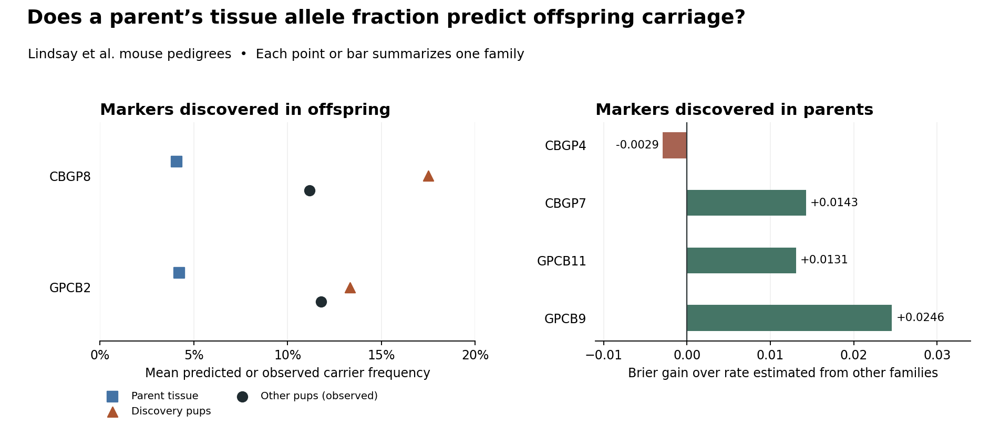

# Can parental mosaicism predict transmission to offspring?

A parent can carry a new mutation in some cells and transmit it to some offspring. Its frequency in a parental tissue is one possible forecast of transmission. We compared that forecast with observed carriage in a discovery sample and with rates learned from other families. Existing mouse data supply both the forecasts and the offspring outcomes for the same mutations. Wild oak data show how much more information is needed to tell *which parent* transmitted an allele. [Lindsay et al., mouse pedigrees](https://doi.org/10.1038/s41467-019-12023-w) · [Plomion et al., oak and acorns](https://doi.org/10.1038/s41477-018-0172-3)

**In two mouse pedigrees, averaging the parental and discovery-offspring measurements improved prediction. Randomly reassigning the parental measurements among comparable markers preserved that advantage on average.** In four other pedigrees, the measured parent fraction helped predict offspring carriage relative to a rate learned from other families. Most of that second advantage can be accounted for by variation in average transmission between families. These are two distinct tests with different ways of discovering the mutations. The study design and the marker-matching control were recorded before reviewing their respective comparison scores. [Analysis specification](https://github.com/maldonado-research/TMD/blob/6b490c4f6a07a370041925e4d75633366dd5766e/research/transmission_fate/DESIGN.md) · [Marker-matching specification](https://github.com/maldonado-research/TMD/blob/a27d0e35fbf34e5e3bf5d8e487acfb825c8410e4/research/transmission_fate/MATCHED_MARKERS.md)

## What a parent’s allele fraction predicts in six mouse families

A simple biological model makes the fraction directly interpretable. If a new variant affects one of two chromosome copies in a fraction f of diploid cells, random sequencing reads from the bulk tissue should carry it about f/2 of the time. If the same fraction f of gamete precursors carries the mutation and segregation is Mendelian, about f/2 of the gametes should carry it too. Parent tissue and gamete precursors can have different developmental histories. The mouse study provides an empirical check on using a somatic tissue fraction directly as a transmission probability.

| How the mutations were found | What was predicted | Compared with | Mean binary Brier gain |
|---|---|---|---:|
| In offspring, 17 confirmed markers across two families | Carriage among other assayed offspring | Parent fraction vs. ten discovery pups’ carrier fraction | −0.00094 |
| Same 17 markers | Same other offspring | Fixed average of parent and discovery fractions vs. discovery fraction | +0.00472 |
| In parents, 26 confirmed markers across four other families | Carriage among their assayed offspring | Parent fraction vs. constant rate learned from the other three families | +0.01226 |

Brier loss is the squared difference between predicted probability and the recorded binary outcome. Positive gain is a reduction in loss against the reference in that row. Each family contributes equal weight and markers contribute equal weight within their family. Multiple measurements from one pup or developmental lineage are related. A list of positive carriers and an assay denominator describe observed transmission with the source’s sensitivity. [Source reconciliation, absolute losses and per-family results](mouse/README.md)



**Offspring-discovered panel.** The mean parental forecast was **4.15%**, the mean discovery forecast **15.42%**, and observed carriage in the remaining assayed offspring **11.47%**, using equal family weights. Supplementary Table 2 reports 57 and 77 assayed offspring per marker. The paper’s pedigree diagram and roster place all ten discovery pups in each assay cohort, leaving 47 and 67 other offspring per marker. Their genotypes were held out of the discovery-frequency forecast, although the source used offspring and parental evidence to validate catalogue membership. The ten discovery pups came from two different litters in each family. This comparison predicts a separate panel of recorded outcomes and has no prospective time cutoff. One marker has a one-carrier disagreement between the paper’s table and workbook. Repeating the analysis with the workbook preserves the direction of both main contrasts. [Source and sensitivity](mouse/README.md)

**Did pairing the right parent measurement with the right marker matter?** Within each family we reassigned parental fractions only among markers found in the same number of discovery pups. The actual pairing scored below the average shuffled pairing. **378,304 out of 622,080** labeled assignments (60.81%) equaled or exceeded the actual parent-only score. For the averaged forecast the observed gain of +0.00472 compares with an average of +0.00480 under shuffled pairings. The two original forecasts typically miss in opposite directions. This explains how averaging improves the score even when the true variant labels confer no measured advantage over this control. Markers can share an ancestral clone. The exact fraction describes a reference distribution for these records, without an independence assumption about families in nature. [Matching test and score identities](matched/README.md)

**Parent-discovered panel.** The other four families had 40 attempted candidates, 26 with confirmed status, including five with zero recorded carrier offspring. The mean parent-based gain of +0.01226 was positive in three of the four families and at 19 of 26 markers. In a descriptive check, +0.00977 of that gain was the cost incurred by the external constant for missing the test family’s mean transmission rate. The remaining gain of +0.00249 compares the parent forecast with the best constant fitted to the observed test-family outcomes. That latter constant is available only in hindsight. Lindsay et al. had already fitted a linear relationship between parental allele fraction and offspring carriage and used it to estimate germline contribution. Our analysis measures performance against specified alternatives on their source-defined rosters. [Parent-ascertained data and QC](mouse/VEE_SOURCE.md) · [Decomposition](mouse/README.md)

## Did the same marker recur in a later litter?

Five whole-genome-sequenced pups from each family’s first litter and five from a later litter provide a separate chronological test. Of 173 validated events documented in an early sequenced pup, 10 also appeared in the later sequenced group. There were 4 such events in one family and 6 in the other. Keeping all the mutations within each pup together, we enumerated all **63,504** balanced reassignments of early and late labels within families. A random split gave an average of 15.40 shared events. The inclusive lower-tail fraction was 0.0370 and the prespecified two-sided fraction was **0.0542**. Preserving the sex composition gave a two-sided fraction of **0.0602**. Most of the shortfall came from one pedigree. Depth varied across litters and the actual litters were biological groups. Lindsay et al. reported that inferred primary lineages were distributed randomly with respect to litter timing. The present comparison counts recorded events spanning the two sequenced litters, a different unit. It gives limited evidence for a general change in transmission over time. [Chronological analysis and exact allocation counts](litters/README.md)

## What 116 acorns reveal about maternal inheritance

In one pedunculate oak, 19 of 21 targeted parental markers amplified. Genotyping embryonic tissue from 116 acorns yielded 1,348 genotype calls in 2,204 possible marker–embryo combinations. Nine markers occurred in at least one embryo. A later supplement reports the parent’s tissue allele fraction for all nine detected markers and for **none of the ten** without an observed carrier. That outcome-dependent availability prevents a fair comparison of the fractions as forecasters across the full panel. The original study’s separate population-frequency column describes other oak trees. [Oak source crosswalk and reconstruction](oak/README.md) · [Xian et al.](https://doi.org/10.1093/g3journal/jkaf143)

One marker makes the distinction between abundance and inheritance concrete. Its observed embryo genotypes contributed 122 alternate copies. Even if every missing genotype carried zero alternate copies, **122 of 232** possible copies is a majority. Of the 108 genotyped embryos, 55 were alternate homozygotes, 12 were heterozygotes and 41 were reference homozygotes. Under accurate diploid Mendelian calls and no new mutation, all 55 alternate homozygotes must have received one alternate copy from the mother. Either parent could have supplied the alternate copy in the 12 heterozygotes. The eight unobserved embryos add eight further possibilities. Thus **55 to 75 of the 116 acorns** could have received this marker maternally. The data establish an embryo allele majority while leaving a maternal transmission majority unresolved. Self-pollination is possible, and parental phase was unmeasured. [Genotype and parent-of-origin bounds](oak/README.md)

We also checked all ten amplified markers assigned to one parental branch. Among called genotypes their alternate allele fraction averaged 10.47 percentage points higher in embryos from the reported branch than in those from the other branch, weighting markers equally. Allowing all missing genotypes to vary gives a range from **−38.32 to +43.71 points**. Only two marker contrasts retain a strict sign under every completion, with opposite directions. This measures the sampled branches of one tree. [Branch-specific results](oak/branch_contrasts.tsv)

## Consequences for Mutation by Natural Dominance

The preceding report established that mutation class was sometimes recoverable even when the first site was ambiguous. Here, an allele measured in a parent is matched to a separate offspring readout. The biology between those observations includes the allocation of cells to the reproductive lineage, segregation, and detection. Family composition and a better calibrated average can explain much of a forecast’s apparent success. A test of a distinctive TMD contribution would need to preserve those ordinary explanations in the baseline and then predict a separately measured difference in persistence or reproduction. Neither mouse carriage nor allele-copy majority in acorns establishes a selective advantage. [0.14.0 first-window report](https://doi.org/10.5281/zenodo.24427842) · [Project formulation](https://github.com/maldonado-research/TMD/blob/f14d1a086dac09f1f884a40743a75b40295f3df3/research/FORMULATION_AND_NEXT_EMPIRICAL_TEST.md)

A targeted literature check through 21 November 2026 found a relevant maize comparison. A February 2026 preprint reported that transposon insertions were shared between siblings 6.2 times as frequently with pollen from a tassel side branch as with bulk or central-spike pollen, despite a similar average number transmitted per offspring. It concerns maize pollen sampling and insertions. It gives a concrete reason to record the reproductive branch when measuring recurrence, and has a different mutation type and sampling design from the oak and mouse studies here. [Scherer et al., preprint](https://doi.org/10.64898/2026.02.05.704067)

## Reproduction

Run the following in this directory using Python 3.10 or newer. It replays the scores from the shipped data, including exact assignment checks. Source-specific instructions cover rebuilding the tables from the original authors’ files. The optional figure uses Matplotlib.

```sh
sh replay.sh
python3 -B plot_forecasts.py
```

Prepared for Ricardo Maldonado’s Mutation by Natural Dominance project with AI assistance. Original analysis code is MIT licensed. Original documentation is CC BY 4.0. Data attributions and the original source terms are given with each extraction.
