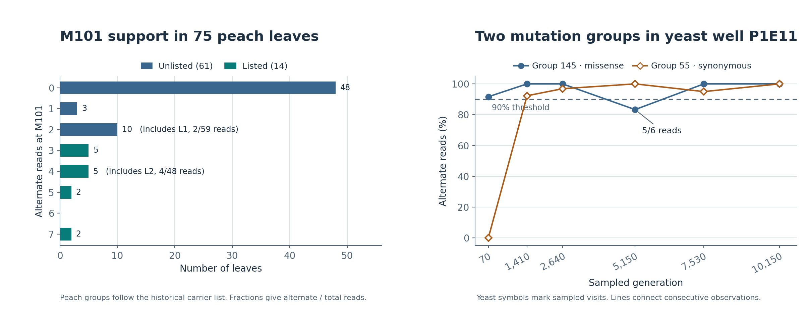

# What was inherited, and which change was observed first?

**Mutation by Natural Dominance · 19 November 2026 · Report and methods supplement 0.10.0**

A prediction that one heritable change will prevail before another needs a measurable meaning for “first.” In 18 laboratory yeast populations, two rules for detecting a marker agreed on the earliest sampled generation in every population. They identified different sets of first markers in 14. In one of those populations, the first group to reach 90% and the first to stay above 90% through follow-up were entirely different. The measurements below show exactly where that distinction arose. [Yeast time series](yeast/YEAST.md) · [Independent check from the original counts](yeast/TIMING_CHECK.md)

**Correction to 0.9.1.** We missed the original 2016 L1 leaf in row 120 of Ji et al.’s S7 workbook. At peach marker M101 it has **2 alternate reads out of 59**. The neighboring L2 leaf has **4 out of 48**. The source therefore resolves the read-count question. Two reads fall below Wang et al.’s three-read minimum for an additional carrier of a shared mutation. The genotype of the focal leaf’s individual cells remains unresolved. The 2019 flower-associated specimen is separate. [Original S7 workbook](https://doi.org/10.1371/journal.pgen.1011829.s021) · [Row-by-row correction and checks](peach/S7_CORRECTION.md) · [Previous version](https://doi.org/10.5281/zenodo.24378187)

## Testing the earlier peach prediction

The two minimum-addition solutions in 0.9.0 agreed on adding M101 to four named leaves. We found all four read counts in the original libraries. In the order B1-1-L1, B1-11-L2, B1-6-L2 and B1-8-L2, they are **2/59, 0/70, 2/60 and 2/51**. Among the eleven *other* B1 leaves omitted from the M101 catalogue, ten also have one or two alternate reads. Weak signal alone singles out none of the three predicted leaves with positive counts. Across all 75 leaves, a cutoff of three alternate reads exactly recovers the original carrier lists for M71 and M101, consistent with the discovery method. [Peach results and native sources](peach/PEACH.md) · [Earlier predictions](https://doi.org/10.5281/zenodo.24377898)

How sensitive was the earlier calculation to adding leaves with no supporting reads? We kept all 48 original marker lists, preserved every listed occurrence, and required a single lineage tree. On such a tree two carrier lists are either disjoint or one contains the other, assuming each marker arises once and persists. We then required each proposed addition at M71 or M101 to have a minimum number of alternate reads. The other 46 markers retain the original freedom to add memberships. Two independent searches gave the following results. [Full numerical results](peach/read_limits.json) · [Independent tree enumeration](peach/peach_gate.json)

| Minimum alternate reads for an addition at either marker | Fewest added memberships across all 48 markers | Minimum tables | M101 in the focal L1 leaf |
|---|---:|---:|---|
| 0 | 12 | 2 | In both |
| 1 | 18 | 2 | In both |
| 2 | 18 | 2 | In both |
| 3 | No feasible table | 0 | — |

Three leaves explain the last row. B1-1-L2 is listed at both markers, so their carrier lists must overlap. B1-1-L1 is listed at M71 but has only two alternate reads at M101. B1-10-L2 is listed at M101 but has zero alternate reads at M71. At three reads neither list can be extended to contain the other. Applying the three-read requirement only to M101 instead admits two minimum tables, each with 30 additions and M101 outside the focal leaf. These are exact results under stated assumptions. Mixed cell populations or a genuine mutation that yields fewer than three reads could violate those assumptions. [Merged source rows](peach/peach_inputs.json) · [Exact search](peach/read_limits.py)

## Transmission into offspring

Seven seedlings from the peach tree offer direct evidence about inheritance. Six had an alternate call at M103, five at M120 and four at both. Every seedling carried at least one of these two markers. No M101 alternate read was observed across the seven seedlings (414 reads combined). The pollen donors were uncontrolled, so these observations alone cannot assign the parental route or date the mutation. Twenty-six parental leaves appear in both S7 and S11. All 52 overlapping marker–leaf count pairs agree across the tables. [Progeny supplement](https://doi.org/10.1371/journal.pgen.1011829.s025) · [Independent crosswalk](peach/S11_CROSSWALK.md)

Guner et al. scored a visible phenotype, dwarf stature, in offspring of loblolly pine mothers. We counted 571 individual marks in their deposited Figure 7. Dwarf offspring numbered 13/155 in genotype A/A, 214/321 in A/G and 86/95 in G/G. Even the best rule assigning one phenotype to each genotype disagrees with **129 of 571 plotted outcomes**. Allowing a different rule in each of the three displayed family panels gives the same minimum. The bound is exact for this figure. The paper’s prose and figure differ by one in two reported margins, and the three related Nana families share one panel. These observations document inheritance and the limits of the linked marker as a phenotype predictor. The study supplies no time of first origin. [Published article](https://doi.org/10.1038/s41437-025-00814-5) · [Panel counts and calculation](pine/FIGURE7.md) · [Independent vector extraction](pine/FIGURE_EVIDENCE.md)

## When does a marker count as first?

Johnson et al. recorded six visits in the same yeast populations, starting at generation 70 and ending at 10,150. We examined 5,759 retained nuclear small-variant records in 5,543 anonymous within-population groups across 18 initially haploid populations in one condition. We compared a threshold at the current adequately covered visit with the authors’ deposited flags, which also use later visits. For the 10% threshold the two definitions disagreed on 1,819 of 34,554 record–visit observations. From the original integer counts we independently reproduced every deposited presence and fixation flag on this panel. At the first sampled 10% crossing, only 2/18 populations had a single first group. At the first sustained 90% crossing, 8/18 did. [Source study](https://doi.org/10.7554/eLife.63910) · [Eligibility, code and results](yeast/YEAST.md)

| P1E11 marker group, alternate / total reads | 70 | 1,410 | 2,640 | 5,150 | 7,530 | 10,150 |
|---|---:|---:|---:|---:|---:|---:|
| Group 145 | 33/36 | 20/20 | 22/22 | **5/6** | 26/26 | 17/17 |
| Group 55 | 0/36 | **12/13** | 31/32 | 9/9 | 19/20 | 10/10 |

Group 145 crossed 90% at the earliest visit. Group 55 was the first to reach 90% and stay above that threshold at every later adequately covered visit. Its qualifying observation occurred at generation 1,410. Omitting only the generation-5,150 measurement makes group 145 the earliest sustained group at generation 70. In this instance, sampling less often moves the inferred start **earlier** and changes the group assigned first. The five-of-six observation is a finite sample. Each connector in the figure joins measured visits and leaves the history between them open. [Independent counts and visit-removal analysis](yeast/TIMING_CHECK.md)

Extending follow-up tests another consequence of the same rule. From generation 7,530 to 10,150, the first sustained generation stayed the same in all 18 populations, yet two populations lost members of their earliest group set. Requiring one later high observation to confirm the initial qualifying visit gave identical earliest sets in all 18 on the complete schedule. All sensitivity analyses hold the full-study discovery catalogue fixed. The archive samples population DNA, and several groups can travel in the same lineage. An origin could precede the first visit or occur during a gap. The strongest testable claim here concerns the order of sampled observations. [Follow-up comparisons](yeast/horizons.json) · [Calculation](yeast/horizons.py)

## Implications for the hypothesis

For a TMD prediction of the first successful heritable route, specify in advance which routes compete, how a lineage identifies each route, what counts as success, when follow-up ends, and how to score ties and routes already present at baseline. An existing TMD prediction concerns first arrivals under specified conditions. These retrospective measurements show why scoring that prediction by the first detected marker or by a marker that stays common can give different answers. A direct biological test still requires independently identified routes, a common time origin and comparable opportunities to observe the competing outcomes. [TMD formulation and first-arrival prediction](https://github.com/maldonado-research/TMD/blob/f14d1a086dac09f1f884a40743a75b40295f3df3/research/FORMULATION_AND_NEXT_EMPIRICAL_TEST.md)

A focused literature search also examined the 2026 yeast study by Martínez and Lang. Its comparisons of whole genomes at the start and at endpoints of 2,400 or 5,000 generations address changes over those intervals. They cannot resolve the order of multiple changes within an interval. The source notes also discuss a barcoded yeast experiment sampled for clone characterization at generation 88 and a 2026 fission-yeast comparison. The shared budding-yeast data in the latter study would duplicate part of the evidence above. [Martínez and Lang](https://doi.org/10.1038/s41467-026-77469-1) · [Additional source comparisons](yeast/YEAST.md)

## Reproduce

Run `bash research/transmission_timing/replay.sh` from the repository or extracted archive. Each source note gives the native-file checks, download links and any additional dependencies. The reduced datasets permit offline calculations. Use `python3 -B research/transmission_timing/plot_observations.py` with matplotlib to redraw the figure. The analysis and writing were prepared with AI assistance for Ricardo Maldonado’s TMD project. [Peach verification](peach/S7_CORRECTION.md) · [Pine verification](pine/FIGURE_EVIDENCE.md) · [Yeast verification](yeast/TIMING_CHECK.md)
